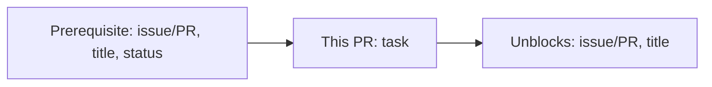
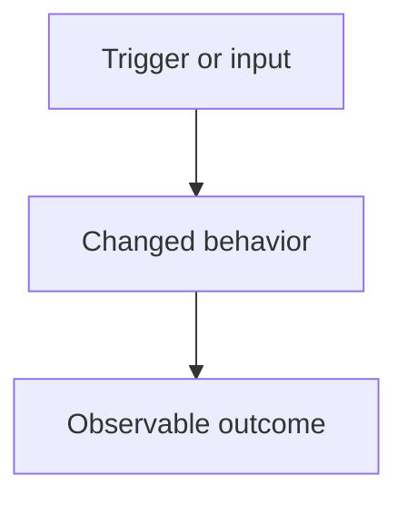

<!--
Explain the outcome, where this task fits, and the evidence that it works.
Replace the example diagrams with this PR's actual work. Keep each diagram small
and remove guidance or checks that do not apply. Link supporting docs for detail.
-->

## Goal

<!-- State the problem and the resulting behavior in 1–2 sentences.
Link the issue or task. Use "Closes #..." only when this PR completes that issue. -->

## Dependency — where this task sits

<!-- Show immediate prerequisites, this PR, and the work it unblocks.
A -> B means B depends on A. Use issue/PR numbers, short titles, and prerequisite
status (open, closed, or merged). Add clickable issue/PR links below the graph.
Remove unrelated nodes. For independent work, keep only the "This PR" node and
state "No prerequisites or known follow-ups." Do not invent dependencies. -->

## What the change does

<!-- Describe the before/after behavior in 1–2 sentences, then replace the example
with ONE Mermaid diagram that best explains the current PR:
- Flowchart (flowchart TD): decisions, branches, or user steps.
- Data flow (flowchart LR): inputs, transformations, storage, and outputs.
  Label arrows with the data that moves between components.
- Sequence (sequenceDiagram): ordered calls or messages across components.
Show the changed path and any failure path needed to understand the change.
For docs or tooling, show the author/reviewer workflow or the artifact flow.
Use real names. Below the diagram, link the files a reviewer should read first. -->

## Non-goals

<!-- State scope exclusions that a reviewer might otherwise expect. -->

## Constraints / invariants

<!-- What would make this change wrong even if tests pass? Include relevant
module boundaries, Arabic rendering requirements, or safety constraints. -->

## Verification

<!-- Keep relevant checks and record commands + outcomes or evidence links.
Explain any relevant check that was not run. -->

- [ ] `pnpm check`
- [ ] `pnpm test:coverage`
- [ ] `pnpm db:setup` (when persistence or migrations changed)
- [ ] `pnpm smoke` (when runtime or API behavior changed)
- [ ] Arabic sanity render or other manual checks, when relevant:

## Risks & rollback

<!-- What can fail, who is affected, and how do we roll back?
Call out irreversible changes or required deployment order. -->

Reviewer context (optional)

<!-- Keep only decisions and references that help review this PR. -->

- **Key decisions and tradeoffs:**
- **Supporting docs:**

## Checklist

**General**

- [ ] I read `README.md` and relevant docs/agdr decision records
- [ ] Canonical terms from `docs/product-strategy.md` are used correctly
- [ ] No new AgDR is required, or an AgDR was added for the decision
- [ ] Docs updated (if needed)
