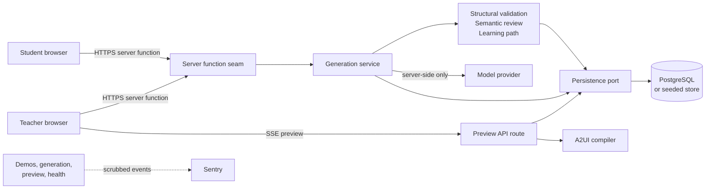
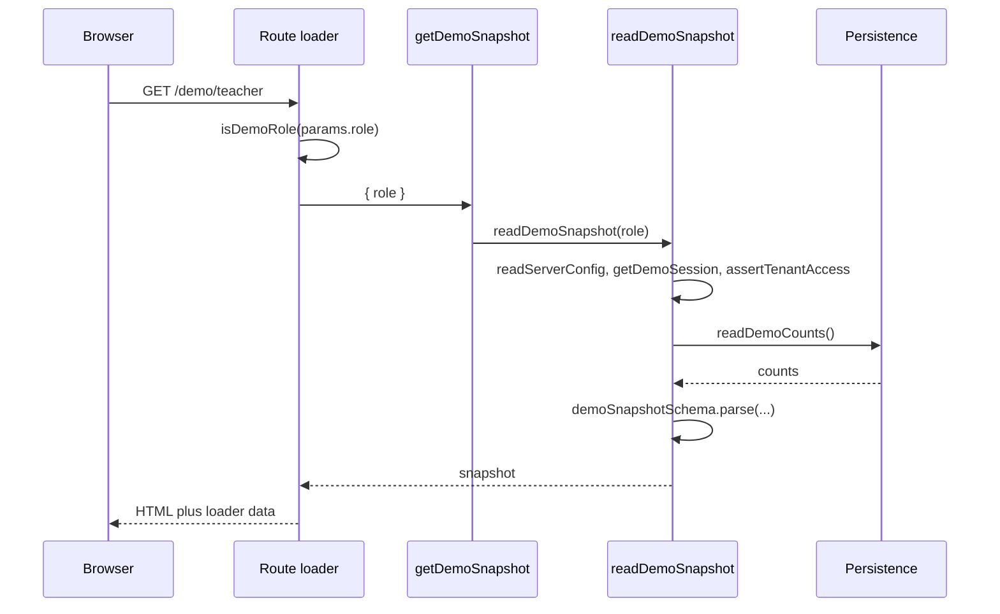
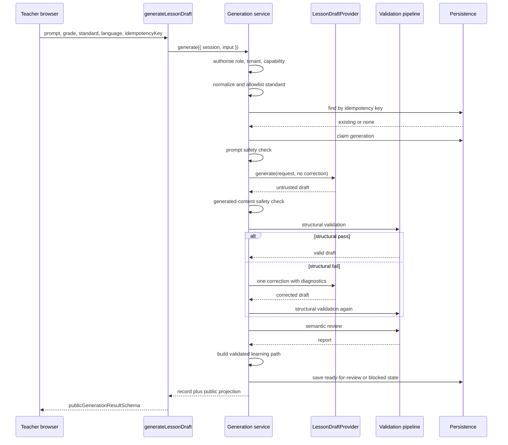
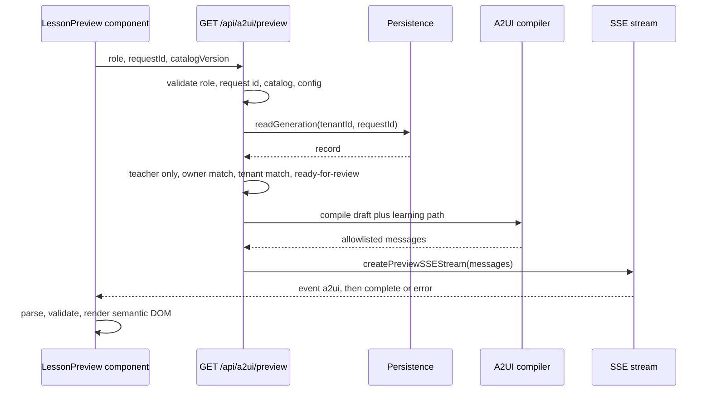

# Architecture

> The operating manual for changing Edu-Canvas. It records what exists at this revision, the boundaries a change must preserve, and one allowed path for each common change. It is written for the next engineer and the next coding agent.

| Field | Value |
| --- | --- |
| Revision | 2026-10-25 |
| Code revision | `a321a15` (`docs/architecture-md`, based on `docs/hackathon-2026-roadmap`) |
| Scope | This repository. Items marked **Target** do not exist yet. |
| Gate | `pnpm check`; CI in `.github/workflows/foundation.yml` |
| Companions | [README](README.md) · [ROADMAP](ROADMAP.md) · [design contracts](docs/design/design-doc.md) · [architecture harness](docs/architecture-harness.md) · [AgDR](docs/agdr/) · [rationale](docs/engineering/architecture-rationale.md) |

**Reading paths**

| Reader | Start at |
| --- | --- |
| New engineer | [System context](#2-system-context-and-trust-boundary) then [runtime flows](#5-runtime-flows) |
| Agent with a task | [Route your change](#1-route-your-change) then the recipe, invariants, and gate |
| Reviewer | [Invariants](#7-invariants), [the cage](#8-the-cage), [known drift](#10-shipped-target-and-known-drift) |

**Precedence.** Code and tests define behavior. This document explains them and points to the gate that proves each rule. When they disagree, the code wins and this document is wrong. Fix it in the same change.

## 1. Route your change

| Change | Recipe | Copy the nearest example | Gate |
| --- | --- | --- | --- |
| Add or replace a generation provider | [6.1](#61-add-a-generation-provider) | `src/server/generation/provider.ts` | `pnpm check` |
| Add a persisted record or persistence method | [6.2](#62-add-a-persisted-record-or-persistence-method) | `src/server/persistence/generation-persistence.ts` | `pnpm test:database`, `pnpm check` |
| Add a server function or API route | [6.3](#63-add-a-server-function-or-api-route) | `src/server/demo/server-function.ts`, `src/routes/api/health.ts` | `pnpm verify:architecture`, `pnpm check` |
| Add a page route | [6.4](#64-add-a-page-route) | `src/routes/demo/$role.tsx` | `pnpm check` |
| Add or change an A2UI component or action | [6.5](#65-add-an-a2ui-component-or-action) | `src/shared/a2ui-contract.ts` + `src/server/a2ui/compiler.ts` | `pnpm check` |
| Change a browser-facing contract | [6.6](#66-change-a-browser-facing-contract) | `src/shared/generation-contract.ts` | `pnpm verify:architecture`, `pnpm verify:client-boundary`, `pnpm check` |
| Add a validator or configuration flag | [6.7](#67-add-a-validator-or-configuration-flag) | `src/server/generation/validation.ts`, `src/server/config.ts` | `pnpm check` |
| Change an architectural rule | [6.8](#68-change-an-architectural-rule) | `scripts/verify-architecture.ts` | `pnpm check` |

**No match.** Search before you invent: `rg -n "<concept>" src scripts`. If no canonical slice exists, do not add another parallel seam. Build the slice and its test in the same change, then add the row here. Deterministic generators for these recipes are a **Target** ([§10](#10-shipped-target-and-known-drift)).

## 2. System context and trust boundary

Edu-Canvas turns a teacher request into a validated lesson draft, compiles the accepted draft into an allowlisted A2UI catalog, and streams a teacher preview. The student half of the loop is designed but not built.

| Actor or system | Role at this revision |
| --- | --- |
| Teacher | Seeded identity. Generates drafts and opens previews. Approval and publication are **Target**. |
| Student | Seeded identity. Reads a role-limited demo snapshot. Attempts and grading are **Target**. |
| Model provider | Untrusted content producer. Called server-side only; its output is parsed, never trusted. |
| PostgreSQL | System of record when configured. Supabase in the release runbook. Private credentials server-side only. |
| Seeded store | Process-local `Map`. Deterministic default for local and CI. Not durable. |
| Sentry | Server-only error reporting. Context keys are allowlisted, and URLs, bearer tokens, emails, and identity-shaped ids are redacted. |

**Trust boundary.** Browser input is untrusted. Provider and upload text is untrusted data, never instructions or markup. A2UI messages are data checked against a closed catalog; no generated HTML or JavaScript executes. The answer map, tenant identity, capabilities, and grading inputs stay server-side. Today the browser supplies its own `role`; that is a demo affordance, not authentication ([§10](#10-shipped-target-and-known-drift)).

| Capability | Status | Where it lives |
| --- | --- | --- |
| Role-limited demo snapshot | Shipped | `src/server/demo/read-model.ts` |
| Lesson generation, validation, persistence | Shipped | `src/server/generation/` |
| Teacher A2UI preview | Shipped | `src/server/a2ui/`, `src/components/a2ui/` |
| Health and readiness | Shipped | `src/server/health.server.ts` |
| Approval and publication | **Target** ([#5](https://github.com/abodacs/edu-canvas/issues/5)) | No code |
| Student attempts, grading, reveal, adaptation | **Target** ([#6–#8](https://github.com/abodacs/edu-canvas/issues/6)) | No code |
| Hard safety gate | **Target** ([#28](https://github.com/abodacs/edu-canvas/issues/28)) | No code |
| Protected sessions and quotas | **Target** ([#74](https://github.com/abodacs/edu-canvas/issues/74), [AgDR-0007](docs/agdr/AgDR-0007-demo-access-and-deployment.md)) | No code |

## 3. Stack, configuration, and version pins

### 3.1 Stack

| Layer | Choice | Version source |
| --- | --- | --- |
| Runtime | Node.js `>=26`, pnpm `10.17.1` | `package.json`, `Dockerfile` |
| Application | TanStack Start, TanStack Router, React 19, Vite 8 | `package.json` |
| Server runtime | Nitro 3 beta, output at `.output/server/index.mjs` | `package.json`, [AgDR-0003](docs/agdr/AgDR-0003-nitro-beta-compatibility.md) |
| Language | TypeScript 6, strict, `verbatimModuleSyntax`, `noUncheckedSideEffectImports` | `tsconfig.json` |
| Contracts | Zod 4 schemas in `src/shared/`; types inferred from schemas | `src/shared/` |
| Data | PostgreSQL 17, `postgres` 3.4, Drizzle ORM 0.45 and `drizzle-kit` 0.31 | `package.json`, `docker-compose.yml` |
| UI | Tailwind 4, Base UI, shadcn/ui, CVA, lucide-react, GSAP | `package.json`, `components.json` |
| Observability | `@sentry/node`, server-only, scrubbed events | `src/server/observability.server.ts` |
| Quality | Ultracite 8 (ESLint 10, Prettier 3, Stylelint), Vitest 4, `tsrs` | `package.json`, `eslint.config.js` |
| Deployment | Multi-stage `node:26-bookworm-slim` image, Fly.io, Supabase Postgres | `Dockerfile`, `fly.toml`, `docs/release-fly-supabase.md` |

### 3.2 Version pins

| Pin | Value | Owner |
| --- | --- | --- |
| A2UI protocol | `v0.9.1` | `src/shared/a2ui-contract.ts` |
| A2UI catalog | `matching-v1`, id `https://edu-canvas.app/a2ui/v0.9.1/catalogs/matching-v1` | `src/shared/a2ui-contract.ts` |
| Prompt template | `lesson-prompt-v1` | `src/server/generation/provider.ts` |
| Structural validator | `lesson-validator-v2` | `src/server/generation/validation.ts` |
| Semantic validators | `curriculum-validator-v1`, `learning-quality-validator-v1`, runner `semantic-validation-runner-v1` | `src/server/generation/semantic-validation-contract.ts` |
| Prerequisite graph | `equivalent-fractions-v1` | `src/server/seed-data.ts` |
| Migrations | Applied in filename order; checksummed; immutable once applied | `scripts/database-migrate-runtime.mjs`, `migrations/` |

A catalog change is a new catalog version, never an in-place edit ([AgDR-0001](docs/agdr/AgDR-0001-a2ui-catalog-governance.md)). Version pins travel with generated drafts and learning paths.

### 3.3 Configuration

`src/server/config.ts` is the only configuration reader. Invalid values produce `ConfigIssue` records; callers fail closed before serving.

| Variable | Effect | Failure code |
| --- | --- | --- |
| `APP_ENV` | `development`, `preview`, `production` | `INVALID_APP_ENV` |
| `DEMO_MODE` | Selects the deterministic fixture provider. Defaults to `true` outside production. | `INVALID_DEMO_MODE` |
| `SYNTHETIC_DATA_ONLY` | Must stay `true`. Real-student mode is disabled. | `REAL_DATA_DISABLED` |
| `DATABASE_URL` | Enables PostgreSQL. Absent means `seeded-demo`. | `DATABASE_REQUIRED`, `INVALID_DATABASE_URL` |
| `PERSISTENCE_ADAPTER` | `postgres` (default) or `drizzle` | `INVALID_PERSISTENCE_ADAPTER` |
| `SENTRY_DSN` | Server-only error delivery | `INVALID_SENTRY_DSN` |
| `OPENAI_API_KEY` | Required when `DEMO_MODE=false` | `OPENAI_API_KEY_REQUIRED` |
| `OPENAI_MODEL` | Default `gpt-5.6` | No default issue |
| `OPENAI_BASE_URL` | HTTPS, or HTTP only on loopback | `INVALID_OPENAI_BASE_URL` |

`pnpm verify:config` prints `safeConfigSummary` and exits non-zero on any issue. It is not part of `pnpm check`.

## 4. Repository map and import law

### 4.1 Folder ownership

| Path | Owns | Must not own |
| --- | --- | --- |
| `src/shared/` | Browser-safe contracts, Zod schemas, pure helpers | Server behavior, Node APIs, database imports |
| `src/routes/` | Delivery: route definitions, loaders, API handlers | Domain rules, persistence choice, tenant policy |
| `src/server/` | Domain services, validation, persistence, delivery seams, observability | React components, route definitions |
| `src/components/` | Semantic UI and A2UI rendering | Server or delivery behavior, data ownership |
| `src/lib/` | Small browser-safe utilities such as `cn` | Domain or persistence logic |
| `src/server/persistence/` | Adapters behind `GenerationPersistence` | Public response shaping |
| `drizzle/` | Drizzle schema and generated metadata | Runtime behavior |
| `migrations/` | Forward-only SQL applied by the runtime runner | Edited history |
| `scripts/` | Gates, operators, smoke checks | Application runtime code |
| `docs/agdr/` | Architecture decisions | Implementation detail |

### 4.2 Import law

`pnpm verify:architecture` scans every `src/**/*.ts` and `src/**/*.tsx` file.

| Importer | May import | Must not import |
| --- | --- | --- |
| `shared` | `shared`, browser-safe `lib` | `server`, `routes`, `components`, `node:*`, `postgres` |
| `components` | `components`, `shared`, `lib` | `server`, `routes` |
| `server` | `server`, `shared`, `lib`, `drizzle` | `routes`, `components` |
| `routes` | `routes`, `components`, `shared`, `lib` | `server` internals |
| `routes` → `server` | Only specs ending `.server` or `/server-function` | Any other server module |

Additional enforced rules:

- No global mutable store: `jotai`, `mobx`, `redux`, `valtio`, `zustand`, `@reduxjs/toolkit`, `createStore`, `configureStore`, `createSlice`, or files named `store.ts`, `global-state.ts`, `app-state.ts`.
- The student demo snapshot must parse against `demoSnapshotSchema` and must not contain the string `answerKey`.

`pnpm verify:client-boundary` adds a bundle-level check after `pnpm build`. It scans `.output/public` for eleven markers: `answerKey`, `OPENAI_API_KEY`, `DATABASE_URL`, `postgresql://`, `SENTRY_DSN`, `SENTRY_AUTH_TOKEN`, `@sentry/node`, `observability.server`, `edu-canvas.server-error.v1`, `sendDefaultPii`, `identity_demo_student`.

### 4.3 Generated or immutable files

| File | Rule |
| --- | --- |
| `src/routeTree.gen.ts` | Generated. Never edit by hand. Prettier ignores it. |
| `drizzle/meta/` | Generated by `drizzle-kit`. Do not hand-edit. |
| `migrations/*.sql` | Append only. An applied file is checksummed and must not change. |
| `.output/` | Build artifact. `verify:client-boundary` depends on it. |
| `pnpm-lock.yaml` | Dependency source of truth. Change it only with an intentional dependency change. |

### 4.4 What steers an agent here

An agent takes the shortest compiling path and copies the nearest example. Each mechanism below makes the right pattern the nearest one; the gaps are the places where the cage cannot yet stop a wrong copy.

| Mechanism | Current implementation | Gap |
| --- | --- | --- |
| Canonical implementations | One provider port, one persistence port, one public projection, one A2UI catalog, one shared contract per boundary | A stale seeded fixture and duplicate AgDR numbers weaken the signal |
| Vertical slices | `src/server/<domain>/` keeps each domain's service, types, and tests together; routes stay thin delivery modules | `src/shared/` and `src/components/` remain layered by technical scope |
| Constrained extension points | `LessonDraftProvider`, `GenerationPersistence`, `ContentSafety`, injected clock, request-id factory, curriculum context, and semantic validator | A new domain still copies a slice by hand |
| Convention-based discovery | File routes and the generated route tree; `.server` and `/server-function` import suffixes are checked | No command or handler registry |
| Schema-driven development | Zod contracts in `src/shared/`, inferred types, Drizzle schema, pinned A2UI catalog | No generated client or OpenAPI document |
| Deterministic scaffolding | None | Add tested generators after the core loop lands |
| Mechanical enforcement | `verify:architecture`, `verify:client-boundary`, types, lint, tests, CI | Coverage gaps listed in [§8](#8-the-cage) |
| Checkpoints | GitHub issues, AgDRs, and the validation tracker hold goals and evidence | Checkpoints are not machine-validated |

## 5. Runtime flows

### 5.1 Demo snapshot read

The snapshot contains `environment`, `session`, `curriculum`, and `seededCounts`. It contains no activity content, no answer map, and no generation record. Teacher capabilities are `view_seeded_environment`, `view_demo_activity_fixtures`, and `generate_lesson_draft`; student capabilities are read-only. Capability policy lives in `src/server/demo/policy.ts`.

### 5.2 Lesson generation

Load-bearing rules:

- `normalizeGenerationInput` parses `lessonGenerationInputSchema`, accepts only the seeded standard id or code, and derives an FNV-1a idempotency key when the client omits one.
- `claimGeneration` gives one owner a 30-second lease (`generationClaimLeaseMs`). A duplicate waits up to five seconds (`generationDuplicateWaitMs`) before resolving the existing record.
- At most one correction call follows a structural failure. The provider throws `LessonProviderError` with kind `timeout`, `rate-limit`, `transient`, or `terminal`; the first three map to `failed-retryable`, the last to `failed-terminal`.
- Semantic review is bounded: curriculum and learning-quality reviews run deterministically; optional advisory agents get at most two attempts and a default 250 ms timeout. One runner version is recorded in provenance.
- A blocked or failed attempt stores diagnostics and `draft: null`. Only `ready-for-review` stores a draft.
- `toPublicGenerationResult` re-parses the response with `publicGenerationResultSchema`. It drops variant `relationships`, the learning path, the record owner, and every private field.

Generation states:

| State | Meaning | Can retry |
| --- | --- | --- |
| `requested` | Record created, attempt not claimed | No |
| `generating` | Claim held or lease live | Waits for owner |
| `ready-for-review` | Validated draft stored | No |
| `blocked-by-validation` | Structural, semantic, or path failure | Yes, with review |
| `blocked-by-moderation` | Prompt or generated content failed safety scan | No; revise request |
| `failed-retryable` | Provider timeout, rate limit, transient error, or validator unavailable | Yes |
| `failed-terminal` | Provider rejected the request or failed unexpectedly | No |

### 5.3 Teacher preview stream

The compiler emits only `Column`, `Row`, `Card`, `Text`, `MatchCard`, `Button`, `Status`, and `LearningPath`. The catalog's action set is `selectSource`, `selectTarget`, `clearSelection`, `requestHint`, `submitAttempt`, `undoInk`, `clearInk`, and `saveProgress`. Every message is validated twice: in the compiler and again in the stream. The browser rejects unknown components, unknown actions, private field names, unsupported styling, and unsafe text.

This is snapshot SSE, not incremental model streaming. The server compiles the full message set, then enqueues frames synchronously. The client aborts after 8 seconds and requires exactly four surfaces. The response sets `cache-control: no-store`, `connection: keep-alive`, `x-edu-canvas-catalog`, and error codes `INVALID_ROLE`, `INVALID_REQUEST_ID`, `UNSUPPORTED_CATALOG`, `PREVIEW_UNAVAILABLE`, `PREVIEW_FORBIDDEN`, `PREVIEW_NOT_FOUND`, `PREVIEW_NOT_READY`, and `PREVIEW_BLOCKED`.

### 5.4 Health and readiness

`GET /api/health` reports process liveness and never touches dependencies. `GET /api/readiness` validates configuration and runs a bounded persistence check; it returns 503 when not ready. Fly checks both endpoints; the Docker image checks health.

### 5.5 Persistence selection and write ownership

`createFoundationPersistence(config)` chooses one adapter:

1. No `DATABASE_URL` → `createSeededPersistence`, a module-level `Map` keyed by tenant and request. Drafts survive requests but not a process restart.
2. `DATABASE_URL` with `PERSISTENCE_ADAPTER=postgres` → `createPostgresPersistence`.
3. `DATABASE_URL` with `PERSISTENCE_ADAPTER=drizzle` → `createDrizzlePersistence`.

All three expose `GenerationPersistence` plus `check()` and `readDemoCounts()`. The two PostgreSQL adapters share `createGenerationPersistence` for claim, compare-and-set save, expiry, idempotency lookup, and tenant-scoped read. The database contract test runs the same cases against both adapters.

Every PostgreSQL operation opens a client and closes it in `withDatabase`; there is no pool at this revision. That is acceptable at milestone scale and is recorded in [§10](#10-shipped-target-and-known-drift).

Writes use compare-and-set on `{ attempt, updatedAt }`. A lost write returns `false`, and the service re-reads the current owner's record instead of overwriting it. Idempotency keys are unique per tenant at the database level.

## 6. Task recipes

Each recipe follows the same shape: copy one example, touch only the listed files, keep the constraints, then run the gate. Do not add a parallel path.

### 6.1 Add a generation provider

**Copy** `src/server/generation/provider.ts`.

**Touch**

1. Implement `LessonDraftProvider`: a `provenance` object and `generate(request, context) → { draft: unknown }`.
2. Add settings and `ConfigIssue` codes in `src/server/config.ts`; document them in `.env.example`.
3. Select the provider in `src/server/generation/factory.ts`.
4. Keep `createDeterministicLessonDraftProvider` for `DEMO_MODE`.
5. Extend `provider.test.ts`, `config.test.ts`, and `service.test.ts`.

**Constraints** Throw `LessonProviderError` with the four supported kinds. Make at most one correction call. Set an explicit deadline. Return `unknown`; validation is not the provider's job. Never call a provider from the browser. Add any new secret marker to `scripts/verify-client-boundary.ts`.

**Gate** `pnpm check`.

### 6.2 Add a persisted record or persistence method

**Copy** `src/server/persistence/generation-persistence.ts` and the two adapter files.

**Touch**

1. Add or extend the type in `src/server/generation/types.ts`.
2. Add the method to `GenerationPersistence` and implement it once in `createGenerationPersistence`.
3. Add both PostgreSQL backends in `postgres.ts` and `drizzle.ts`.
4. Mirror durable state in `seeded.ts` for demo parity.
5. Add the Drizzle table in `drizzle/schema.ts` and a new forward-only `migrations/00NN_*.sql`.
6. Extend `src/server/persistence/persistence-contract.test.ts`.

**Constraints** Every query is tenant-scoped; schema policies use `current_setting('app.tenant_id')`. Keep the claim and compare-and-set semantics. Do not add a third migration history: the runtime uses `app_migrations`, and Drizzle tooling has its own metadata. Never edit an applied migration. Put domain code in `src/server/<domain>/`; do not create top-level `services/`, `controllers/`, or `models/` folders.

**Gate** `docker compose up -d postgres`, then `pnpm test:database`, then `pnpm check`.

### 6.3 Add a server function or API route

**Copy** `src/server/demo/server-function.ts` for mutations and reads used by routes; `src/routes/api/health.ts` for a plain HTTP handler.

**Touch**

1. Create or extend `src/server/<domain>/server-function.ts` or a `*.server.ts` delivery module.
2. Validate input with a Zod schema at the seam.
3. Build dependencies inside the handler: `readServerConfig`, `createFoundationPersistence`, the configured provider, then the service.
4. Return a shared public schema, never the internal record.
5. For an API route, add `src/routes/api/<name>.ts` and delegate to the `*.server` handler.

**Constraints** The route may import server code only when the specifier ends `.server` or `/server-function`; a file named `server-functions.ts` fails the gate. Call `getDemoSession` and `assertTenantAccess` inside the handler. A browser role parameter grants no authority. Set `cache-control: no-store` on private responses.

**Gate** `pnpm verify:architecture`, `pnpm check`.

### 6.4 Add a page route

**Copy** `src/routes/demo/$role.tsx`.

**Touch** Add `src/routes/<path>.tsx` with `createFileRoute`. Read data in `loader`; mutate through a server function. Keep the page component thin.

**Constraints** Do not edit `src/routeTree.gen.ts`; the router plugin generates it. Vitest includes only `src/**/*.test.ts`, so a colocated `.test.tsx` will not run. `__root.tsx` owns the document shell. Add any new public path to `scripts/smoke.ts`.

**Gate** `pnpm check`, then `pnpm build && pnpm start && pnpm smoke` for a runtime path.

### 6.5 Add an A2UI component or action

**Copy** the `Status` or `LearningPath` entry in `src/shared/a2ui-contract.ts`.

**Touch**

1. Add the name to `a2uiComponentNames` or `a2uiActionNames`.
2. Add a strict schema branch to the discriminated union.
3. Emit it from `src/server/a2ui/compiler.ts`.
4. Render it in `src/components/a2ui/renderer.ts` and, when needed, `lesson-preview.tsx`.
5. Extend `a2ui-contract.test.ts`, `compiler.test.ts`, and `renderer.test.ts`.

**Constraints** The catalog is closed. Unknown components and actions fail with `UNKNOWN_COMPONENT` or `UNKNOWN_ACTION`; styling or markup keys fail with `UNSUPPORTED_PROPERTY`; private field names fail with `UNSAFE_PAYLOAD`. Text is checked for markup and script schemes. A catalog change requires a new catalog version ([AgDR-0001](docs/agdr/AgDR-0001-a2ui-catalog-governance.md)). Never add raw HTML or an execution path.

**Gate** `pnpm check`.

### 6.6 Change a browser-facing contract

**Copy** `src/shared/generation-contract.ts`.

**Touch**

1. Edit the Zod schema and infer the TypeScript type from it.
2. Update the producer: `projection.ts`, `compiler.ts`, or the server function.
3. Update the consumer: the route or component.
4. Update the sibling `*.test.ts`.

**Constraints** `src/shared/` cannot import server, routes, components, `node:*`, or `postgres`. Keep schemas strict. `publicLessonDraftSchema` requires exactly four variants. Drop private fields in the projection, not in the component. If the field reaches the demo snapshot, update `demoSnapshotSchema` and the public-contract check.

**Gate** `pnpm verify:architecture`, `pnpm verify:client-boundary`, `pnpm check`.

### 6.7 Add a validator or configuration flag

**Copy** `src/server/generation/validation.ts` for a structural rule, `curriculum-validator.ts` for a semantic review, and `src/server/config.ts` for a flag.

**Touch** Validator: add a versioned finding with `validator`, `verdict`, and `validatorVersion`, then wire it into `semantic-validation.ts`. Flag: add a `ConfigIssueCode`, a parse branch, `.env.example` documentation, and `config.test.ts`.

**Constraints** Validators return diagnostics, never throw for expected failures. Warnings remain visible to the teacher; blocks keep drafts out of the preview. Configuration fails closed. Do not hide a rule in prose.

**Gate** `pnpm check`.

### 6.8 Change an architectural rule

**Copy** the closest rule in `scripts/verify-architecture.ts` or `eslint.config.js`.

**Touch** Add the check first. Record the reason in `docs/agdr/`. Update `docs/architecture-harness.md` and this document. Add a test fixture that fails without the rule.

**Constraints** Never weaken a gate to pass a diff. A rule that can be a type, lint rule, test, or script does not belong in prose. If a rule genuinely needs a new owner or exception, name the owner in a decision record.

**Gate** `pnpm check`.

## 7. Invariants

| ID | Rule | Enforced by |
| --- | --- | --- |
| I1 | Layer direction holds: shared is browser-safe, UI owns no runtime, server owns no delivery. | `scripts/verify-architecture.ts` |
| I2 | The browser receives only fields in a strict public schema. Private fields are dropped at the projection. | `projection.ts`, `demoSnapshotSchema`, `verify:architecture` |
| I3 | No secret, provider key, database URL, Sentry marker, or student identity reaches the public bundle. | `scripts/verify-client-boundary.ts` |
| I4 | One owner may claim and write a generation attempt. Writes use compare-and-set. | `GenerationPersistence`, `service.ts`, database contract test |
| I5 | A generation is idempotent per tenant and key. A retry keeps the original request metadata. | FNV-1a keys, unique database key, `service.ts` |
| I6 | Only a validated `ready-for-review` draft can be previewed, and only by its teacher in its tenant. | `preview.server.ts` |
| I7 | A2UI is a closed catalog of semantic components. No generated HTML, JavaScript, or unknown action executes. | `src/shared/a2ui-contract.ts`, compiler, stream, renderer |
| I8 | Tenant access is asserted on every read and write; real-student data stays disabled. | `policy.ts`, tenant-scoped SQL, `src/server/config.ts` |
| I9 | There is no hidden global mutable state. State has one owner. | `verify:architecture` store bans, local React state |
| I10 | Validation fails closed: a blocked or failed attempt stores diagnostics and no draft. | `service.ts`, public projection |

These invariants are architectural. Product rules such as approval before publication and server-authoritative grading are **Target** contracts in [docs/design/design-doc.md](docs/design/design-doc.md); they are not enforced by code yet.

## 8. The cage

The cage is the set of automatic checks that reject a change. Prose is the last resort, not the first.

| Command | Proves | Notes |
| --- | --- | --- |
| `pnpm format:check` | Formatting matches Prettier | `pnpm fix` rewrites |
| `pnpm lint` | ESLint and Ultracite rules pass | Includes React, Router, Vitest, import, a11y, and JSDoc plugins |
| `pnpm lint:styles` | Stylelint passes | BEM pattern |
| `pnpm typecheck` | `tsc --noEmit` passes | Strict, unused checks, `verbatimModuleSyntax` |
| `pnpm typecheck:tsrs` | Additional project type check passes | `tsrs --noEmit` |
| `pnpm test` | Vitest unit and integration tests pass | Only `src/**/*.test.ts` |
| `pnpm build` | Vite and Nitro produce a server bundle | Output in `.output/` |
| `pnpm verify:client-boundary` | Public bundle has no private markers | Requires a prior build |
| `pnpm verify:architecture` | Import law, state ownership, delivery seams, and public snapshot hold | Scans `src/` only |
| `pnpm check` | All of the above pass in order | The local gate |
| `pnpm test:database` | Both PostgreSQL adapters pass the same contract | Needs a running container |
| `pnpm test:coverage` | Coverage floors hold: lines 50, branches 65, functions 46, statements 50 | Below the eventual 80% target |
| `pnpm smoke` | Health, readiness, demo pages, and a deterministic generation request work | Needs a running server |
| `pnpm verify:config` | Configuration summary is valid | Not part of `pnpm check` |

CI adds what local `pnpm check` does not: `db:drizzle:check`, a first `db:setup`, `test:coverage`, a repeated bootstrap, `test:database`, a Docker image build, a container health and readiness check, and two smoke runs. The workflow is `.github/workflows/foundation.yml`.

**What the cage does not cover.** `verify:architecture` scans `src/` only. It does not inspect `scripts/`, SQL, CSS, generated output, or the SSR bundle. `verify:client-boundary` scans only `.output/public`. Vitest ignores `.tsx` tests. Those gaps are deliberate at this size; add a check before adding a rule that needs one.

**Changing the cage.** A recurring review finding becomes a check, test, or type in the same change. Never answer the same finding twice in prose. Update `docs/architecture-harness.md` for the rationale and this document for the map.

## 9. Deployment and runtime topology

| Environment | Shape |
| --- | --- |
| Local | `pnpm dev` on port 3000. Seeded mode by default; optional Postgres via `docker compose up -d postgres` and `pnpm db:setup`. |
| CI | PostgreSQL 17 service, full gate, database contract, Docker build, container smoke, then a native server smoke. |
| Milestone deploy | One Fly.io Machine in `ams`, Supabase Postgres, migrations as a release command, health and readiness checks. **Target** configuration per [AgDR-0007](docs/agdr/AgDR-0007-demo-access-and-deployment.md). |
| Production | Not authorized. Real data, protected auth, shared rate limits, backups with restore evidence, DPA and residency approval remain open. |

The runtime image is multi-stage, runs as the `node` user, binds port 3000, and serves `.output/server/index.mjs`. The migration runner acquires a bootstrap lock, applies SQL files in filename order, and records a SHA-256 checksum in `app_migrations`.

**Scale constraint.** Preview streaming is request-scoped, and the seeded store plus any future in-process limits are process-local. Do not scale horizontally until quota and request-limit state is shared. [AgDR-0007](docs/agdr/AgDR-0007-demo-access-and-deployment.md) records one Machine for the milestone for this reason.

## 10. Shipped, target, and known drift

### 10.1 Capability status

See the table in [§2](#2-system-context-and-trust-boundary). The short version: the teacher generation and preview path is real; approval, publication, student attempts, grading, reveal, adaptation, protected sessions, and quotas are not in this checkout. Do not describe a **Target** item as shipped.

### 10.2 Known drift and debt

| Item | Current state | Impact | Default |
| --- | --- | --- | --- |
| Deployment count | `fly.toml` sets `min_machines_running = 2`; AgDR-0007 and the runbook say one Machine | Process-local limits and SSE assumptions break at two instances | Align `fly.toml` to one Machine, or share limit state before scaling |
| Provider naming | Factory and environment variables are `OPENAI_*`; AgDR-0006 selects a provider-agnostic adapter | A provider swap looks larger than it is; documents may name the wrong model | Land the adapter rename; record the exact model only after access evidence |
| Provider deadline | Adapter uses `AbortSignal.timeout(15_000)`; AgDR-0006 records a 10-second per-call deadline | A claimed deadline is not the implemented deadline | Make code and decision agree before citing either |
| Seeded store | Module-level `Map` in `persistence.ts` | Not durable, not shared, not multi-instance | Use PostgreSQL for any shared environment |
| Database connections | Every operation opens and closes a client in `withDatabase` | Connection churn at scale | Add pooling behind the persistence port before production load |
| Seeded activity fixture | `activityVersion.catalogVersion` is `edu-canvas-matching-v0`; the live preview catalog is `matching-v1` | An agent may copy the stale fixture | Keep the fixture off the preview path; do not copy its catalog version |
| Authentication | Browser supplies `role` to demo server functions | Public access would be impersonation | Protected sessions before any public link ([#74](https://github.com/abodacs/edu-canvas/issues/74)) |
| Missing loop slices | No approval, publication, grading, or adaptation code | The loop cannot be called learner-safe | Build the slices in issue order; keep claims to preview |
| Generators | Recipes are prose; no scaffold command exists | Agents can still invent a seam | Add tested generators once the core loop stabilizes |
| Coverage | Floors are lines 50, branches 65, functions 46, statements 50 | Regressions pass below the 80% target | Ratchet upward as loop slices land ([#70](https://github.com/abodacs/edu-canvas/issues/70)) |
| Threat model | Still names OpenAI GPT-5.6 | Security review names a provider the decision record does not promise | Update with the provider adapter change |
| AgDR numbering | Three records share `AgDR-0003` | A citation by number alone is ambiguous | Cite the full slug; renumber on the next decision record |

## 11. Decisions and maintenance

| Record | Decision |
| --- | --- |
| [AgDR-0001](docs/agdr/AgDR-0001-a2ui-catalog-governance.md) | Real A2UI v0.9.1 with a custom, allowlisted catalog |
| [AgDR-0002](docs/agdr/AgDR-0002-server-authoritative-grading.md) | Server-authoritative grading with answer-key isolation |
| [AgDR-0003](docs/agdr/AgDR-0003-canonical-lesson-contract-and-bounded-generation.md) | Canonical lesson contract and bounded generation |
| [AgDR-0003](docs/agdr/AgDR-0003-nitro-beta-compatibility.md) | Keep Nitro 3 beta while Vite 8 is pinned |
| [AgDR-0003](docs/agdr/AgDR-0003-server-observability.md) | Server-only observability with scrubbed Sentry delivery |
| [AgDR-0004](docs/agdr/AgDR-0004-bounded-semantic-validation.md) | Bounded semantic validation at the generation seam |
| [AgDR-0005](docs/agdr/AgDR-0005-grounded-package-version-contracts.md) | Grounded lesson-package and version contracts |
| [AgDR-0006](docs/agdr/AgDR-0006-provider-selection-and-deadlines.md) | Provider-agnostic selection and bounded deadlines |
| [AgDR-0007](docs/agdr/AgDR-0007-demo-access-and-deployment.md) | Single-instance demo access and deployment |

Write an AgDR when a choice changes a boundary, an invariant, a public contract, a dependency direction, or the enforcement cage. Do not write one for a local implementation choice.

Update this document in the same change when a boundary, flow, recipe, invariant, or drift item changes. Keep it short. The [rationale](docs/engineering/architecture-rationale.md) records why this document has this shape; it is not a second architecture.

**This document does not own:** product status or the demo contract ([README](README.md)), outcomes and release gates ([ROADMAP](ROADMAP.md)), feature scope and acceptance checks ([design contracts](docs/design/design-doc.md)), decision rationale ([AgDR](docs/agdr/)), guardrail rationale ([architecture harness](docs/architecture-harness.md)), setup and redeploy ([runbooks](docs/foundation-runbook.md)), or threats ([threat model](docs/security/threat-model.md)).

## 12. Glossary

| Term | Meaning |
| --- | --- |
| Lesson draft | The provider's structured proposal: four variants, items, hints, feedback, and an optional learning path. Untrusted until validated. |
| Variant | One content option (`standard`, `scaffold`, `challenge`). Variants are not teaching stages. |
| Learning path | A validated, version-pinned prerequisite sequence stored with a ready draft. |
| Diagnostic | A typed warning or error with a code, message, optional variant or node, and validator version. |
| Public projection | The strict shape sent to the browser. Private fields are removed here. |
| Generation claim | The 30-second lease that gives one request owner the right to write. |
| A2UI | A declarative UI message protocol. The server emits catalog components; the browser renders semantic DOM. |
| The cage | The automated checks that reject a change. |
