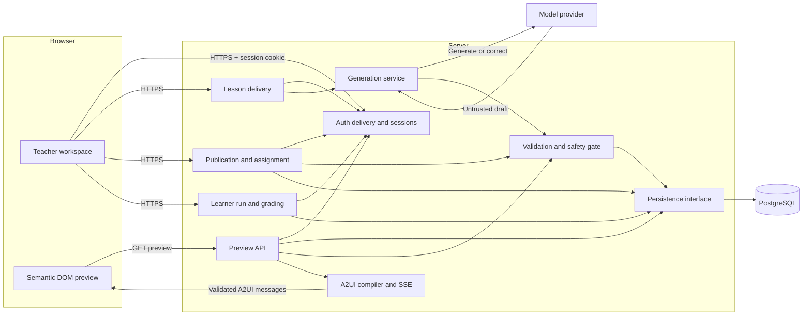
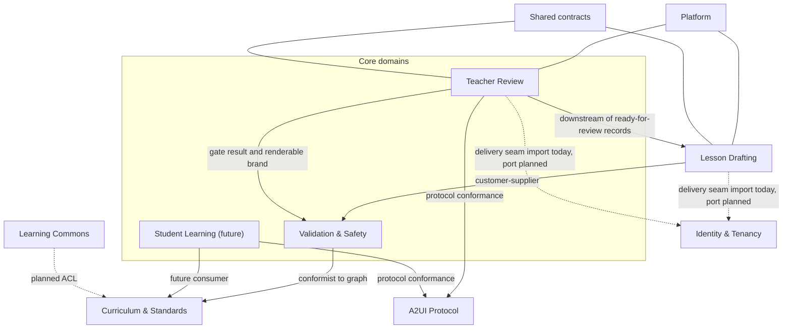
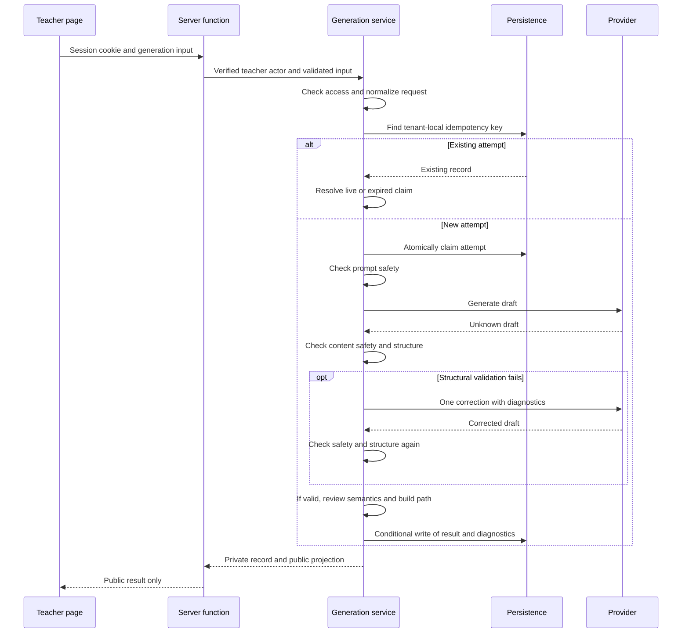

# Architecture

Edu-Canvas is a full-stack TanStack Start application. Its implemented loop runs from a teacher prompt to a published lesson and a graded learner attempt: authenticate, ground the request in the seeded curriculum or an uploaded source, generate and validate four variants, preview through A2UI, review and approve a version, publish it, assign it to a learner, and grade a server-authoritative attempt. Adaptation, the connection reveal, and teacher evidence remain target contracts.

This document describes the code inspected on **2026-11-01**, using `07a065a` as the source baseline. It owns module boundaries, runtime flows, state ownership, and the checks that protect them. [Design contracts](docs/design/design-doc.md) own intended behavior; [AgDRs](docs/agdr/) own decision rationale; [runbooks](docs/foundation-runbook.md) own setup and operation. A disagreement between this document and the implementation is documentation drift, not permission to change behavior.

| Reader's question | Start here |
| --- | --- |
| What runs, and where does data go? | [System overview](#system-overview) |
| Which module owns this change? | [Module ownership](#module-ownership) |
| Which contexts exist and how do they relate? | [Bounded contexts and context map](#bounded-contexts-and-context-map) |
| Where will the code move, and in what order? | [Target layout and migration waves](#target-layout-and-migration-waves) |
| What crosses the browser boundary? | [Contracts and trust boundaries](#contracts-and-trust-boundaries) |
| How do generation and preview work? | [Runtime flows](#runtime-flows) |
| How do I extend the system? | [Change recipes](#change-recipes) |
| What verifies the rules? | [Invariants and verification](#invariants-and-verification) |
| What differs from the design? | [Implementation gaps and drift](#implementation-gaps-and-drift) |

## System overview

The browser and server are built together, but domain behavior lives under `src/server/`. Routes reach that behavior through named server functions or `.server` modules. Browser-safe schemas live under `src/shared/`.



Generation is request-driven. There is no background job queue. The generation response returns a public result; a separate request retrieves the persisted draft as an SSE preview. SSE transports an already compiled snapshot, not incremental model output.

The learner surface is one page. `/learn?assignment=&variant=` opens a run and posts matches to `/api/learner/runs` and `/api/learner/attempts`. Grading is server-authoritative: the private answer relationships stay on the server, and the response carries only score, correctness, and counts. Adaptation, the connection reveal, and teacher evidence remain unimplemented.

### Runtime and dependencies

| Concern | Implementation | Authority |
| --- | --- | --- |
| Runtime | Node.js 26 or later; pnpm 10.17.1 | [package.json](package.json), [Dockerfile](Dockerfile) |
| Application | TanStack Start and Router, React 19, Vite 8, Nitro 3 beta | [package.json](package.json), [vite.config.ts](vite.config.ts) |
| Contracts | TypeScript 6 and Zod 4 | [tsconfig.json](tsconfig.json), `src/shared/` |
| UI | Tailwind 4, Base UI, shadcn/ui, semantic DOM | `src/components/`, `src/styles.css` |
| Storage | PostgreSQL 17; raw SQL or Drizzle query adapter | `src/server/persistence/`, [docker-compose.yml](docker-compose.yml) |
| Error reporting | Structured server events and optional Sentry delivery | [observability.server.ts](src/server/observability.server.ts) |
| Delivery | Node container on Fly.io; Supabase Postgres in the release design | [fly.toml](fly.toml), [release runbook](docs/release-fly-supabase.md) |

Dependency versions belong in `package.json` and `pnpm-lock.yaml`. The [Nitro compatibility decision](docs/agdr/AgDR-0013-nitro-beta-compatibility.md) explains the beta runtime constraint.

## Module ownership

| Location | Owns | Entry points |
| --- | --- | --- |
| `src/routes/` | Pages, route parameters, loaders, HTTP delivery, page-local interaction state | `src/routes/api/`, `src/routes/login.tsx`, `src/routes/workspace.tsx` |
| `src/server/identity/` | Provider adapter contract, verified actor construction, session establishment/resolution/expiry/logout, CSRF and rate limits, trusted provisioning, browser-safe session projection | [service.ts](src/server/identity/service.ts), [api.server.ts](src/server/identity/api.server.ts), [persistence-port.ts](src/server/identity/persistence-port.ts) |
| `src/routes/api/auth/`, `src/routes/api/lessons/` | Authenticated delivery seams; they resolve an actor and delegate, and never select a role | `context.ts`, `sign-in.ts`, `generate.ts` |
| `src/server/generation/` | Generation policy, attempts, validation, provider interface, learning path, public projection | [service.ts](src/server/generation/service.ts), [types.ts](src/server/generation/types.ts) |
| `src/server/a2ui/` | Preview access checks, compilation, SSE delivery | [preview.server.ts](src/server/a2ui/preview.server.ts), [compiler.ts](src/server/a2ui/compiler.ts) |
| `src/server/safety/` | Artifact gate verdicts, findings, renderable-artifact brand, recovery policy, and enforcement before preview | [artifact-gate.ts](src/server/safety/artifact-gate.ts), [artifact-enforcement.ts](src/server/safety/artifact-enforcement.ts) |
| `src/server/grounding/` | Source upload limits, extraction, gap states, source gate, and public projection | [source-service.ts](src/server/grounding/source-service.ts), [delivery.server.ts](src/server/grounding/delivery.server.ts) |
| `src/server/moderation/` | Deterministic prompt, generated-content, and source-text screening | [content-safety.ts](src/server/moderation/content-safety.ts) |
| `src/server/records/` | Versioned lesson-package records, learner-run and attempt vocabulary, explicit projections, hashes, private answers | [authoring.ts](src/server/records/authoring.ts), [projections.ts](src/server/records/projections.ts), [vocabulary.ts](src/server/records/vocabulary.ts) |
| `src/server/publication/` | Review versions, per-target approvals, the publication fact, the learner assignment, and the pack→record bridge | [service.ts](src/server/publication/service.ts), [delivery.server.ts](src/server/publication/delivery.server.ts), [record-bridge.ts](src/server/publication/record-bridge.ts) |
| `src/server/learner/` | Run start and server-authoritative matching grading | [delivery.server.ts](src/server/learner/delivery.server.ts), [grading.ts](src/server/learner/grading.ts) |
| `src/server/persistence.ts` and `src/server/persistence/` | Adapter selection, record storage, atomic claims, conditional writes, database access | [persistence.ts](src/server/persistence.ts), [generation-persistence.ts](src/server/persistence/generation-persistence.ts), [records-commands.ts](src/server/persistence/records-commands.ts) |
| `src/shared/` | Browser-safe input and output schemas, protocol definitions, inferred public types | [generation-contract.ts](src/shared/generation-contract.ts), [a2ui-contract.ts](src/shared/a2ui-contract.ts), [story-plan.ts](src/shared/story-plan.ts) |
| `src/components/a2ui/` | Stream consumption, local render state, catalog rendering | [lesson-preview.tsx](src/components/a2ui/lesson-preview.tsx), [renderer.ts](src/components/a2ui/renderer.ts) |
| `src/components/ui/`, `src/lib/` | UI primitives and browser-safe utilities | `button.tsx`, `utilities.ts` |
| `src/start.ts`, `src/server/security-headers.ts` | Request middleware for CSP nonce and baseline headers, selected by response class | [start.ts](src/start.ts), [security-headers.ts](src/server/security-headers.ts) |
| `drizzle/` | Authoritative schema source, generated SQL migrations, query types, journal metadata | [schema.ts](drizzle/schema.ts), `0000_baseline.sql`–`0012_special_susan_delgado.sql` |
| `scripts/` | Verification, database bootstrap, smoke checks, benchmarks | [verify-architecture.ts](scripts/verify-architecture.ts), [verify-architecture-map.ts](scripts/verify-architecture-map.ts) |

The server functions compose configuration, provider, persistence, and service. The generation service owns the workflow; provider adapters do not decide whether a draft is acceptable. Persistence owns concurrency rules; routes do not coordinate database transactions.

### Dependency direction

The intended direction is routes → named server delivery modules → domain behavior → persistence or provider interfaces. Shared contracts remain usable by both browser and server. The [context map](#bounded-contexts-and-context-map) refines these layer rules into per-context relationships.

The [architecture verifier](scripts/verify-architecture.ts) rejects these imports:

| Importer | Rejected dependency |
| --- | --- |
| `src/shared/` | Server, routes, components, `node:*`, `postgres`, and `postgres/*` |
| `src/components/` | Server, routes, and source files classified outside the named layers |
| `src/server/` | Routes and components |
| `src/routes/` | Server imports whose specifier ends in neither `.server` nor `/server-function` |

The same scan rejects selected global-store packages, store constructors, and filenames such as `store.ts`. This protects known conventions. It does not prove that arbitrary mutable state or every indirect unsafe import is absent. In particular, `src/lib/` has no dedicated dependency rule, and the seeded generation store is an intentional module-level `Map`.

`src/routeTree.gen.ts` is generated by the router. `.output/` is build output. `drizzle/schema.ts` is the schema source. SQL under `drizzle/` is generated from it and applied in journal order; the runner rejects edited or out-of-order migrations.

## Bounded contexts and context map

Contexts are derived from the teaching loop's verbs — draft → validate → preview → approve → publish → grade → adapt — and named with the [product strategy](docs/product-strategy.md)'s terms. Classification follows the 2026-10-26 competitive read: standards-aligned drafting is a commodity, so the moat is the gated loop and its trust gates. [AgDR-0008](docs/agdr/AgDR-0008-bounded-contexts-and-screaming-layout.md) records this decision.

| Context | Class | Owns | Code today |
| --- | --- | --- | --- |
| Lesson Drafting | Supporting | Provider port, attempts, idempotency, correction policy, public projection | `src/server/generation/` (service, provider, factory, projection, types) |
| Validation & Safety | Core | Structural validation, curriculum alignment, learning-quality review, artifact gate (verdicts, findings, renderable-artifact brand, recovery policy), validated learning path, forward story | Validators, `learning-path.ts`, and [story-plan.ts](src/shared/story-plan.ts); gate, enforcement, and recovery policy in `src/server/safety/` |
| Teacher Review | Core | Preview access checks, A2UI compilation and SSE delivery, review versions, per-target approval, the publication fact and assignment; replacement is a target | `src/server/a2ui/`, `src/components/a2ui/`, `src/server/publication/`, `src/server/records/`; [AgDR-0012](docs/agdr/AgDR-0012-generated-pack-publication-records.md) |
| Student Learning | Core | Learner assignment, run start, server-authoritative matching grade; mastery, adaptation, and the connection reveal are targets | `src/server/learner/`, `src/server/records/`, `/learn`, `/api/learner/*`; [AgDR-0002](docs/agdr/AgDR-0002-server-authoritative-grading.md) |
| Curriculum & Standards | Supporting | Seeded standards, versioned prerequisite graph, bounded source uploads, Learning Commons grounding (target) | `src/server/seed-data.ts`, `src/server/grounding/`; [AgDR-0005](docs/agdr/AgDR-0005-grounded-package-version-contracts.md) |
| Identity & Tenancy | Supporting | Sessions, roles, capabilities, tenant membership, CSRF, rate limits, trusted provisioning | `src/server/identity/`; [#98](https://github.com/abodacs/edu-canvas/issues/98), [#99](https://github.com/abodacs/edu-canvas/issues/99) |
| A2UI Protocol | Supporting | Catalog governance, message schemas, compiler and renderer conformance | [a2ui-contract.ts](src/shared/a2ui-contract.ts); [AgDR-0001](docs/agdr/AgDR-0001-a2ui-catalog-governance.md) |
| Shared contracts | Published language | Browser-safe input and output schemas | `src/shared/` |
| Platform | Generic | Persistence adapters, configuration, observability, health, identifier minting, UI primitives | `src/server/persistence*`, `config.ts`, `observability.server.ts`, `ids.ts`, `src/lib/`, `src/components/ui/` |



| Relationship | Pattern | Status |
| --- | --- | --- |
| Drafting → Validation & Safety | Customer–supplier; the service orchestrates validators and owns acceptance | Implemented |
| Drafting, Teacher Review → Validation & Safety (artifact gate) | Customer–supplier; only `gateArtifact` mints a renderable artifact, and both acceptance and preview consume it | Implemented; preview re-derives the gate on every request |
| Validation & Safety (artifact gate) → Drafting | Conformist to the record contracts and the structural validator only | Implemented; no orchestration import |
| Drafting, Validation → Curriculum & Standards | Conformist to the versioned prerequisite graph | Direct seed-data imports today; context port is wave 2 |
| Learning Commons → Curriculum & Standards | Anticorruption layer (planned) | [AgDR-0005](docs/agdr/AgDR-0005-grounded-package-version-contracts.md) design; seed stand-in |
| Teacher Review → Lesson Drafting | Downstream consumer of `ready-for-review` records | Read-only through the persistence port |
| Teacher Review, Student Learning → A2UI Protocol | Conformist to a published, versioned protocol | Implemented for review; protocol owns no business operation |
| Browser and server seams → Shared contracts | Published language, not a shared kernel | Implemented |
| Drafting, Teacher Review → Identity & Tenancy | Customer–supplier through an identity port (target) | Imports pass through the identity delivery seam today; waves 3–4 replace them |
| All contexts → Platform | Generic services behind ports | Implemented |

A context decision changes through an AgDR first, then this map, then the rules — in the same PR.

## Target layout and migration waves

The screaming layout names top-level folders after contexts so the tree tells the product story. `routes/` stays: file-based routing is the framework's delivery seam. Physical moves are deferred until after the November 4 event; until then the map and rules above are the contract. [AgDR-0008](docs/agdr/AgDR-0008-bounded-contexts-and-screaming-layout.md) owns the rationale.

```text
src/
  drafting/            # Lesson Drafting — provider port, attempts, idempotency
  validation/          # Validation & Safety — structure, curriculum, quality, safety gates
  teacher-review/      # Teacher Review — preview projection, access checks, approval
  student-learning/    # Student Learning — publish, attempt, grade, adapt (wave 5)
  curriculum/          # Curriculum & Standards — versioned graph, grounding adapter
  identity/            # Identity & Tenancy — sessions, roles, membership
  a2ui/                # A2UI protocol context
    contract.ts        #   browser-safe protocol contract
    server/            #   compiler, SSE stream, preview access
    ui/                #   stream consumption, render state, catalog rendering
  platform/            # persistence, config, observability, health
  shared/              # published language — browser-safe Zod contracts
  ui/                  # generic UI primitives and browser-safe utilities
  routes/              # framework delivery seam (stays thin)
```

Old-path → new-path mapping (every physical move the waves will make):

| Wave | Old | New |
| --- | --- | --- |
| 1 | `src/server/persistence.ts`, `src/server/persistence/` | `src/platform/persistence/` |
| 1 | `src/server/config.ts`, `src/server/observability.server.ts`, `src/server/health.server.ts` | `src/platform/` |
| 1 | `src/lib/`, `src/components/ui/` | `src/ui/` |
| 2 | `src/server/seed-data.ts` | `src/curriculum/` (with a versioned context port) |
| 2 | `src/server/grounding/` | `src/curriculum/grounding/` |
| 3 | `src/server/generation/` service, provider, factory, projection, errors, types | `src/drafting/` |
| 3 | `src/server/generation/` validators and `learning-path.ts` | `src/validation/` |
| 3 | `src/server/safety/` | `src/validation/safety/` |
| 3 | `src/server/identity/` | `src/identity/` |
| 4 | `src/server/a2ui/` | `src/a2ui/server/` |
| 4 | `src/shared/a2ui-contract.ts` | `src/a2ui/contract.ts` |
| 4 | `src/components/a2ui/` | `src/a2ui/ui/` |
| 5 | — (greenfield) | `src/student-learning/` |

Wave rules: one context per PR, `pnpm check` (including `verify:boundaries`) green each step, rules and this document updated in the same PR. Ordered by hackathon risk first (nothing moves before the event), then by the issues each wave unblocks:

| Wave | Moves and extraction | Retires (warn rules) | Unblocks |
| --- | --- | --- | --- |
| 0 (this change) | Context map, rules, backlog enumeration | — (breaks 2 type cycles) | All waves |
| 1. Platform spine | Persistence, config, observability, health, UI primitives | — | Every later wave moves against a stable platform |
| 2. Curriculum & Standards | Seed data behind a versioned context port | `drafting-imports-seed-curriculum-directly` | [#30](https://github.com/abodacs/edu-canvas/issues/30) standards packs; AgDR-0005 grounding adapter |
| 3. Drafting + Validation | Split `generation/`; session-owned actor boundary | — | [#105](https://github.com/abodacs/edu-canvas/issues/105) AgDR-0006 conformance, [#106](https://github.com/abodacs/edu-canvas/issues/106) eval set, [#98](https://github.com/abodacs/edu-canvas/issues/98) auth prerequisite |
| 4. Teacher Review | A2UI tri-fold (contract, server, ui); authenticated preview | — | [#29](https://github.com/abodacs/edu-canvas/issues/29) catalog generalization, [#110](https://github.com/abodacs/edu-canvas/issues/110) catalog unify, [#5](https://github.com/abodacs/edu-canvas/issues/5) approval |
| 5. Student Learning | Greenfield in the target layout | — | [#5](https://github.com/abodacs/edu-canvas/issues/5)–[#8](https://github.com/abodacs/edu-canvas/issues/8), [#19](https://github.com/abodacs/edu-canvas/issues/19), [#107](https://github.com/abodacs/edu-canvas/issues/107) |

Flipping a warn rule to error is part of its wave's PR. A new warn may not be introduced outside a planned wave.

## Contracts and trust boundaries

### Browser requests and public results

The workspace posts a schema-validated input to `/api/lessons/generate` with the session cookie and the session-bound challenge header `x-edu-canvas-csrf`:

```ts
const response = await fetch("/api/lessons/generate", {
  method: "POST",
  headers: {
    "content-type": "application/json",
    "x-edu-canvas-csrf": challenge,
  },
  body: JSON.stringify({
    prompt: "Create an equivalent-fractions matching lesson.",
    grade: 4,
    standardId: "4.NF.A.1",
    language: "en",
    idempotencyKey: "fractions-request-001",
  }),
});
```

The parsed response body satisfies `PublicGenerationResult`, inferred from [generation-contract.ts](src/shared/generation-contract.ts). The input schema accepts grades 3–6; the service restricts the standard to the seeded equivalent-fractions standard ID or code. Current contracts accept English and Arabic, although the release scope is English-only.

The service returns both a private `LessonGenerationRecord` and a public result. [delivery.server.ts](src/server/generation/delivery.server.ts) returns only the latter. [toPublicGenerationResult](src/server/generation/projection.ts) explicitly selects public fields and parses the strict output schema. It removes relationship mappings, tenant and teacher ownership, attempt history, and the private draft's learning path.

That learning path has a separate, validated public representation in A2UI preview data. Removing it from the generation response does not mean all learning-path information is private.

Session data uses [identity-contract.ts](src/shared/identity-contract.ts). The projection exposes only session status and the actor's display fields; cookies, provider credentials, and forgery checks stay server-side.

**Access model:** identity is session-derived. The browser never supplies a role. `resolveProtectedTeacher` verifies the session, current membership, and teacher role, then requires a valid origin and session challenge before mutation. The preview resolves the same actor and checks record ownership again.

### Provider output and validated drafts

[LessonDraftProvider](src/server/generation/provider.ts) exposes provenance and one operation: `generate(request, context) → Promise<{ draft: unknown }>`. The context carries correction status and diagnostics. Returning `unknown` keeps acceptance policy in the generation service.

The service transforms provider data through structural validation, semantic review, and learning-path construction. A `LessonDraft` contains four content variants and a validated path with version pins. Variant kinds are `standard`, `scaffold`, and `challenge`; kinds are not teaching stages.

Relationship mappings stay server-side. Model text is data, never executable HTML or JavaScript. Deterministic content safety screens the prompt, generated content, and source text. The artifact gate then evaluates the stored record before preview and hard-blocks any draft that fails.

### A2UI messages

[a2ui-contract.ts](src/shared/a2ui-contract.ts) owns protocol `v0.9.1`, the `matching-v1` and `fractions-v2` catalogs, allowed components and actions, safe text rules, and message schemas. Compiler, stream, and browser renderer validate against that contract.

Catalog actions such as `submitAttempt` describe allowed messages. Their presence does not establish a working submission or grading endpoint. The current preview renders semantic DOM without executing generated markup.

### Configuration and telemetry

[config.ts](src/server/config.ts) parses application and database-bootstrap settings. Invalid settings produce typed `ConfigIssue` records. Generation, preview, readiness, and persistence reject invalid configuration.

`DATABASE_URL` is required: PostgreSQL is the only runtime persistence. `OPENAI_API_KEY` is required for server-side generation. `PERSISTENCE_ADAPTER` selects raw SQL or Drizzle against the same database. `SYNTHETIC_DATA_ONLY=false` is rejected. The deterministic provider and in-memory stores are test doubles and are unreachable from runtime composition.

[observability.server.ts](src/server/observability.server.ts) emits structured errors, restricts context values, redacts sensitive patterns, and optionally sends scrubbed events to Sentry. Sentry uses `sendDefaultPii: false`. This is a server-only interface, not a browser SDK.

## Runtime flows

### Establish a session

`/login` and `/sign-up` post to `/api/auth/*`. [service.ts](src/server/identity/service.ts) verifies provider credentials, establishes an opaque server-owned session, sets HttpOnly cookies, and returns a browser-safe projection. Development uses a deterministic local provider; preview and production require Supabase settings. Protected routes resolve the session on every request and re-check membership and expiry.

### Generate a lesson



[createGenerationService](src/server/generation/service.ts) owns these decisions:

1. Authorize the session teacher and normalize the input. An omitted idempotency key is derived from normalized request data using FNV-1a.
2. Resolve an existing tenant-local key, or claim a new attempt before calling the provider. A losing claimant resolves the winner's record.
3. Check prompt and generated-content safety. Structural failure permits one correction, so an attempt makes at most two generation calls.
4. Run deterministic curriculum and learning-quality reviews. Warnings remain visible; blocks prevent an accepted draft.
5. Build a forward learning path and story against the versioned seeded curriculum. Missing or incompatible context blocks acceptance.
6. Persist the final state with the expected attempt, update timestamp, and an unexpired lease. If ownership has changed, return the current record instead of overwriting it.

The configured factory always builds the OpenAI Responses adapter; the deterministic provider is a test double. The live adapter uses a 100-second timeout per call. The service enforces a 200-second total budget across generation and one correction.

| State | Meaning | Explicit retry |
| --- | --- | --- |
| `requested` | Initial service record before claim | No |
| `generating` | An attempt holds a claim | Resolve existing attempt |
| `ready-for-review` | Accepted draft and learning path stored | No |
| `blocked-by-validation` | Structure, semantics, or path rejected | Yes |
| `blocked-by-moderation` | Prompt or content safety rejected | Revise and start a new request |
| `failed-retryable` | Timeout, rate limit, transient provider error, or unavailable validation | Yes |
| `failed-terminal` | Terminal or unexpected provider failure | No |

Blocked and failed attempts retain diagnostics with no accepted draft. `ready-for-review` means previewable, not teacher-approved or published.

### Compile and stream a preview

`LessonPreview` requests `/api/a2ui/preview` with a session, `requestId`, and a catalog version. [preview.server.ts](src/server/a2ui/preview.server.ts) validates parameters and configuration, requires the authenticated teacher, and loads the record by tenant and request ID. The record must belong to that teacher and contain a `ready-for-review` draft. The artifact gate runs again on the stored record before any message is compiled.

[compiler.ts](src/server/a2ui/compiler.ts) projects the private draft into allowlisted components and preview data, including the validated learning path and forward story. [fraction-compiler.ts](src/server/a2ui/fraction-compiler.ts) compiles the `fractions-v2` activity. [stream.ts](src/server/a2ui/stream.ts) validates messages again and emits SSE `a2ui` events followed by completion or error. Browser stream parsing and rendering live in `src/components/a2ui/` and keep render state local.

### Review, approve, and publish a pack

`/api/publications/review` returns a review pack for a `ready-for-review` record the teacher owns. An edit inserts a new `pack_versions` row with a parent link; nothing updates or deletes a version. Approvals are per target and pinned to the artifact and validation-result hashes. Publish re-runs the artifact gate over the stored revision, rejects a stale hash, and writes one publication and one assignment. [record-bridge.ts](src/server/publication/record-bridge.ts) then appends the lesson version, publication, and assignment that the learner runtime reads.

### Open and grade a learner run

`/api/learner/runs` resolves the student session, opens or replays a run keyed by `operationKey`, and returns the assigned variant's sections. `/api/learner/attempts` rejects a stale `expectedRunRevision`, grades the submitted pairs against the private answer relationships, and writes the attempt only after grading succeeds. The response carries score, correctness, and counts; the answer key never leaves the server.

### Persist and recover attempts

[GenerationPersistence](src/server/generation/types.ts) provides claim, expiry, conditional save, idempotency lookup, and record read operations. The service does not know SQL or Drizzle transaction details.

A claim has a 220-second lease. Duplicate callers poll for up to five seconds. Expiry is resolved by request handling; there is no background reaper. Conditional writes compare attempt number, update timestamp, and an unexpired lease, so an expired worker cannot overwrite a replacement attempt.

Both PostgreSQL adapters use [createGenerationPersistence](src/server/persistence/generation-persistence.ts) for shared claim and write policy. They supply transactions, savepoints, tenant context, and queries. Generation queries constrain tenant IDs, and SQL policies use transaction-local `app.tenant_id`. The seeded adapter implements the same public port against the process-local map.

The database records requests separately from attempt history. SQL migrations also define the seeded activity, version, graph, and attempt tables; those tables do not imply that the student application flow exists.

## Change recipes

These are extension paths through existing owners. New domain behavior belongs in a named server module with a narrow delivery interface.

| Change | Implementation path | Constraints and verification |
| --- | --- | --- |
| Add a model provider | Implement `LessonDraftProvider` in `generation/provider.ts` or a sibling adapter. Select it in `factory.ts`; add settings in `config.ts` and `.env.example`. | Return unknown draft data and provenance. Map failures to `LessonProviderError`. Keep correction policy in the service. Extend provider, config, and service tests. Add new secret markers to the client scan. |
| Add persisted state | Extend the domain type and persistence port. Implement storage in the raw SQL and Drizzle adapters; keep the in-memory store as a test double. Change `drizzle/schema.ts`, run `pnpm db:generate`, and use `generate --custom` only for forced RLS, triggers, or functions. | Preserve tenant scoping, atomic claims, conditional writes, and adapter parity. Run database contract tests against a migrated database. |
| Add a server operation | Add a domain-owned `.server` delivery module and a thin `src/routes/api/...` handler; start from `/api/lessons/generate`. Parse inputs and project outputs at the boundary. | Keep domain rules and database access behind the delivery interface. Verify architecture imports and public schemas. |
| Add a page | Add a file route using `routes/workspace.tsx` as the authenticated example. Load data through named server interfaces and keep interaction state local. | Regenerate routes with `pnpm generate-routes`. Do not hand-edit `routeTree.gen.ts`. Check the built client boundary. |
| Change A2UI | Start with `shared/a2ui-contract.ts`, then update compiler, stream expectations, renderer, and their tests together. | Version catalog changes under the [catalog-governance decision](docs/agdr/AgDR-0001-a2ui-catalog-governance.md). Preserve rejection of unknown messages and private data. |
| Change a public contract | Change the owning shared Zod schema, its server projection, consumers, and tests together. | Keep server record types private. A schema edit alone does not update an explicit projection. |
| Add validation or configuration | Put draft acceptance rules in generation validation. Put application settings in `config.ts`, with typed issue codes and safe summaries. | Test pass, warning, block, or invalid-setting behavior as applicable. Keep secrets out of responses and diagnostics. |
| Change a boundary | Record the decision in an AgDR, update the verifier and the `.dependency-cruiser.cjs` rules and affected callers, then update this map. | Run `pnpm verify:architecture`, `pnpm verify:boundaries`, and the full `pnpm check` gate. Document enforcement limits rather than claiming complete isolation. |

The repository has no deterministic scaffold command for these recipes. [Coding standards](CODING_STANDARDS.md) own general implementation conventions.

## Invariants and verification

| Invariant | Mechanism | Limit |
| --- | --- | --- |
| Routes cross named server delivery interfaces | `verify:architecture` import scan | Selected source patterns, not a complete dependency graph |
| Context boundaries hold and the graph stays acyclic | `verify:boundaries` dependency-cruiser rules | Warn-severity debt is enumerated, not resolved; generated router edge excluded; cruises `src/` only |
| Public responses use explicit contracts | Snapshot parsing and generation projection schemas | Each new response path needs its own projection and checks |
| Private markers stay out of shipped browser assets | `verify:client-boundary` scans `.output/public` | Fixed string list; does not inspect the server bundle or all possible sensitive values |
| One claimant owns a generation write | Atomic claims and compare-and-set persistence; service and database contract tests | The 200-second generation budget is separate from the 220-second lease |
| Retry metadata stays consistent | Service checks owner, retryable state, normalized request fields, and the persisted request hash | A hash collision would defeat changed-payload detection; FNV-1a is not cryptographic |
| Only accepted, owned drafts reach preview | `preview.server.ts` access, ownership, state, and gate checks | Identity is session-derived; the record must belong to the calling teacher |
| A2UI remains a closed data protocol | Shared schemas, compiler, stream, and renderer validation | Catalog support does not implement the associated business operation |
| Storage remains tenant-scoped | Tenant predicates, transaction-local tenant context, SQL policies, parity tests | Application access depends on the session-derived actor |
| Protected mutations require a live session and challenge | `resolveProtectedTeacher`, origin guard, and `x-edu-canvas-csrf` | Development uses a deterministic identity provider, not a production one |
| Every response carries baseline security headers | `src/start.ts` middleware selects a policy by path class and stamps the CSP nonce on the SSR bootstrap | Headers are policy controls, not proof against injected content |
| Real-data mode remains disabled | Configuration rejects `SYNTHETIC_DATA_ONLY=false` | This flag cannot identify personal data embedded in free text |

`pnpm check` runs formatting, ESLint, Stylelint, TypeScript, tsrs, Vitest, the application build, client-boundary verification, architecture verification, the architecture-map check, and dependency-boundary verification in order. [package.json](package.json) owns the exact command chain.

Additional checks have separate prerequisites:

| Command | Scope and prerequisite |
| --- | --- |
| `pnpm test:database` | Runs adapter parity tests when `DATABASE_URL` is supplied. Sets `RUN_DATABASE_TESTS=true`; the suite skips without a database URL. |
| `pnpm test:coverage` | Enforces coverage floors from `vitest.config.ts`; separate from `pnpm check`. |
| `pnpm verify:config` | Reports safe configuration and fails on configuration issues. |
| `pnpm smoke` | Checks a running server: pages, health, readiness, header policy, and a rejected unauthenticated preview. |
| `pnpm verify:client-boundary` | Requires an existing build. Run `pnpm build` first when validating a code change. |

[Foundation CI](.github/workflows/foundation.yml) adds PostgreSQL setup, Drizzle-history and schema-drift checks, repeated migration and seed runs, coverage, adapter parity, Docker build, and container and native-server smoke checks.

Verification coverage is bounded. The architecture scanner reads TypeScript under `src/`; it does not inspect SQL, operator scripts, or CSS. Its import extraction uses regular expressions. Vitest selects `src/**/*.test.ts`, so `.test.tsx` files are outside that configuration. Passing these checks does not establish browser interaction coverage or production readiness. [Architecture harness](docs/architecture-harness.md) records guardrail intent.

## Deployment and runtime topology

The [Dockerfile](Dockerfile) builds `.output/`, copies runtime dependencies and the migration runner, runs as `node`, and serves `.output/server/index.mjs` on port 3000. Fly runs migrations as a release command. The runner locks bootstrap, rejects edited or out-of-order journal entries, and applies SQL through Drizzle's hash ledger.

`/api/health` reports liveness. `/api/readiness` validates configuration and checks persistence. Neither endpoint proves live provider access or lesson quality.

[src/start.ts](src/start.ts) applies the security-header policy to every response by path class (document, API, stream) and passes the CSP nonce to the inline hydration bootstrap.

The seeded store is local to one process and disappears on restart. PostgreSQL is required for shared durable records. SSE state belongs to each response and is rebuilt from persisted data on a new preview request.

The release design selects one continuously running Fly Machine with database-backed quotas and process-local burst limits. Those controls are targets. Multiple Machines can serve persisted snapshots, but the planned process-local limits require either a single instance or shared limit state. [AgDR-0007](docs/agdr/AgDR-0007-demo-access-and-deployment.md) records that tradeoff; the [release runbook](docs/release-fly-supabase.md) owns launch requirements.

## Implementation gaps and drift

These differences were checked against the source baseline above. They are not resolved by this document.

| Area | Implemented state | Target or consequence |
| --- | --- | --- |
| Teaching loop | Generation, teacher preview, review and approval, publication, assignment, and server-authoritative learner grading | The connection reveal, teacher evidence and override, mastery, and adaptation remain unimplemented ([#7](https://github.com/abodacs/edu-canvas/issues/7), [#8](https://github.com/abodacs/edu-canvas/issues/8), [#107](https://github.com/abodacs/edu-canvas/issues/107)). |
| Grounding | Seeded curriculum, prerequisite graph, and bounded PDF/TXT/MD uploads with explicit gap states | Learning Commons retrieval, Jev matching, and grounded package contracts remain design work described in [AgDR-0005](docs/agdr/AgDR-0005-grounded-package-version-contracts.md). |
| Safety | Deterministic content screening with a category and code, structural validation, bounded semantic review, and the artifact gate before preview and publication | Teacher-facing moderation recovery is [#119](https://github.com/abodacs/edu-canvas/issues/119). The prompt is still persisted before screening. |
| Identity and cost controls | Session-owned identity, current membership checks, CSRF/origin guards, bounded counters, and trusted provisioning; the role-selected demo surface is retired | [#98](https://github.com/abodacs/edu-canvas/issues/98) stays open for the remaining account and roster evidence. Deployment, rollback, and monitoring gates remain pending. Least-privilege database roles belong to [#100](https://github.com/abodacs/edu-canvas/issues/100). |
| Provider selection | Fixture or OpenAI Responses adapter with `OPENAI_*` settings and a `gpt-5.6` code default | [AgDR-0006](docs/agdr/AgDR-0006-provider-selection-and-deadlines.md) selects a provider through access evidence. The code default is not evidence for an event-allowed provider. |
| Deadlines | 100 seconds per provider call, 200 seconds for generation plus correction, and a 220-second claim lease; writes require an unexpired lease | AgDR-0006 event decision, 2026-10-27. |
| Idempotency conflicts | An existing tenant-local key compares the persisted normalized request hash; changed input returns `IDEMPOTENCY_CONFLICT` without a provider call | AgDR-0006 requires the conflict; unchanged input reuses the original result. |
| Machine count | `fly.toml` sets `min_machines_running = 2` | AgDR-0007 and the release procedure select one Machine for the planned limit model. |
| Connections | Each database operation creates and closes a client | There is no application-wide connection pool. |
| Seeded catalog | Fixture activity uses `edu-canvas-matching-v0` | Live preview uses `matching-v1` or `fractions-v2`; the activity fixture is not the preview catalog authority. |
| Context boundary debt | Drafting imports seed data directly | Curriculum context port (wave 2) per [AgDR-0008](docs/agdr/AgDR-0008-bounded-contexts-and-screaming-layout.md); tracked as a `verify:boundaries` warn rule. |
| Record model duplication | Publication writes the approved pack into `pack_*` and again into `lesson_*` through [record-bridge.ts](src/server/publication/record-bridge.ts) | One lesson has two stored representations. Collapsing them is an accepted follow-up; until then the bridge is the only writer of the second copy. |

## Document maintenance

Update this document when a change alters ownership, a public boundary, a runtime flow, concurrency behavior, or an enforcement mechanism. Update a drift row when its implementation lands. Keep future contracts in the design documents and decision rationale in AgDRs.

The [document rationale](docs/engineering/architecture-rationale.md) records the alternatives considered for this rewrite. [README](README.md) owns product orientation and current status; [ROADMAP](ROADMAP.md) owns delivery order and outcome gates. This document provides the implementation map those documents link to.
