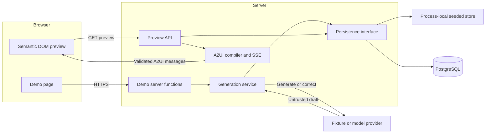
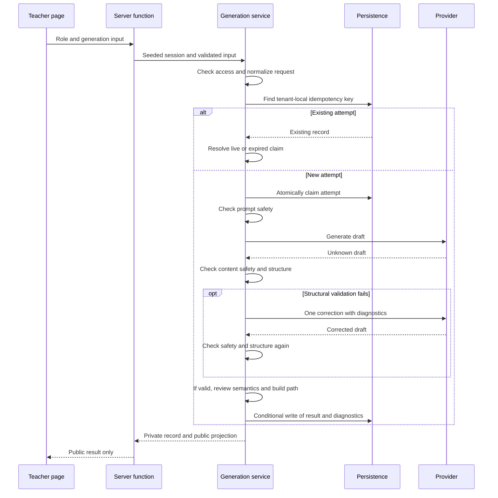

# Architecture

Edu-Canvas is a full-stack TanStack Start application. Its implemented teaching path takes a synthetic teacher request, generates and validates a lesson draft, persists the result, and renders a teacher preview through A2UI. Approval, publication, student submissions, grading, and adaptation remain target contracts.

This document describes the code inspected on **2026-10-26**, using `7229785` as the source baseline. It owns module boundaries, runtime flows, state ownership, and the checks that protect them. [Design contracts](docs/design/design-doc.md) own intended behavior; [AgDRs](docs/agdr/) own decision rationale; [runbooks](docs/foundation-runbook.md) own setup and operation. A disagreement between this document and the implementation is documentation drift, not permission to change behavior.

| Reader's question | Start here |
| --- | --- |
| What runs, and where does data go? | [System overview](#system-overview) |
| Which module owns this change? | [Module ownership](#module-ownership) |
| What crosses the browser boundary? | [Contracts and trust boundaries](#contracts-and-trust-boundaries) |
| How do generation and preview work? | [Runtime flows](#runtime-flows) |
| How do I extend the system? | [Change recipes](#change-recipes) |
| What verifies the rules? | [Invariants and verification](#invariants-and-verification) |
| What differs from the design? | [Implementation gaps and drift](#implementation-gaps-and-drift) |

## System overview

The browser and server are built together, but domain behavior lives under `src/server/`. Routes reach that behavior through named server functions or `.server` modules. Browser-safe schemas live under `src/shared/`.



Generation is request-driven. There is no background job queue. The generation response returns a public result; a separate request retrieves the persisted draft as an SSE preview. SSE transports an already compiled snapshot, not incremental model output.

The student demo currently reads an environment snapshot. It does not run the planned activity, submission, or grading loop.

### Runtime and dependencies

| Concern | Implementation | Authority |
| --- | --- | --- |
| Runtime | Node.js 26 or later; pnpm 10.17.1 | [package.json](package.json), [Dockerfile](Dockerfile) |
| Application | TanStack Start and Router, React 19, Vite 8, Nitro 3 beta | [package.json](package.json), [vite.config.ts](vite.config.ts) |
| Contracts | TypeScript 6 and Zod 4 | [tsconfig.json](tsconfig.json), `src/shared/` |
| UI | Tailwind 4, Base UI, shadcn/ui, semantic DOM | `src/components/`, `src/styles.css` |
| Storage | PostgreSQL 17; raw SQL or Drizzle query adapter | `src/server/persistence/`, [docker-compose.yml](docker-compose.yml) |
| Error reporting | Structured server events and optional Sentry delivery | [observability.server.ts](src/server/observability.server.ts) |
| Delivery | Node container on Fly.io; Supabase Postgres in the release design | [fly.toml](fly.toml), [release runbook](docs/release-fly-supabase.md) |

Dependency versions belong in `package.json` and `pnpm-lock.yaml`. The [Nitro compatibility decision](docs/agdr/AgDR-0003-nitro-beta-compatibility.md) explains the beta runtime constraint.

## Module ownership

| Location | Owns | Entry points |
| --- | --- | --- |
| `src/routes/` | Pages, route parameters, loaders, HTTP delivery, page-local interaction state | [demo/$role.tsx](src/routes/demo/$role.tsx), `src/routes/api/` |
| `src/server/demo/` | Synthetic sessions, capabilities, tenant assertions, environment snapshot, server-function composition | [server-function.ts](src/server/demo/server-function.ts), [policy.ts](src/server/demo/policy.ts) |
| `src/server/generation/` | Generation policy, attempts, validation, provider interface, learning path, public projection | [service.ts](src/server/generation/service.ts), [types.ts](src/server/generation/types.ts) |
| `src/server/a2ui/` | Preview access checks, compilation, SSE delivery | [preview.server.ts](src/server/a2ui/preview.server.ts), [compiler.ts](src/server/a2ui/compiler.ts) |
| `src/server/persistence.ts` and `src/server/persistence/` | Adapter selection, record storage, atomic claims, conditional writes, database access | [persistence.ts](src/server/persistence.ts), [generation-persistence.ts](src/server/persistence/generation-persistence.ts) |
| `src/shared/` | Browser-safe input and output schemas, protocol definitions, inferred public types | [generation-contract.ts](src/shared/generation-contract.ts), [a2ui-contract.ts](src/shared/a2ui-contract.ts) |
| `src/components/a2ui/` | Stream consumption, local render state, catalog rendering | [lesson-preview.tsx](src/components/a2ui/lesson-preview.tsx), [renderer.ts](src/components/a2ui/renderer.ts) |
| `src/components/ui/`, `src/lib/` | UI primitives and browser-safe utilities | `button.tsx`, `utilities.ts` |
| `migrations/` | Authoritative executable database schema, RLS, constraints, triggers | `0001_foundation.sql`, `0002_lesson_generation.sql` |
| `drizzle/` | Query-typing schema and introspection metadata | [schema.ts](drizzle/schema.ts), [ownership notes](drizzle/README.md) |
| `scripts/` | Verification, database bootstrap, smoke checks, benchmarks | [verify-architecture.ts](scripts/verify-architecture.ts) |

The server functions compose configuration, provider, persistence, and service. The generation service owns the workflow; provider adapters do not decide whether a draft is acceptable. Persistence owns concurrency rules; routes do not coordinate database transactions.

### Dependency direction

The intended direction is routes → named server delivery modules → domain behavior → persistence or provider interfaces. Shared contracts remain usable by both browser and server.

The [architecture verifier](scripts/verify-architecture.ts) rejects these imports:

| Importer | Rejected dependency |
| --- | --- |
| `src/shared/` | Server, routes, components, `node:*`, `postgres`, and `postgres/*` |
| `src/components/` | Server, routes, and source files classified outside the named layers |
| `src/server/` | Routes and components |
| `src/routes/` | Server imports whose specifier ends in neither `.server` nor `/server-function` |

The same scan rejects selected global-store packages, store constructors, and filenames such as `store.ts`. This protects known conventions. It does not prove that arbitrary mutable state or every indirect unsafe import is absent. In particular, `src/lib/` has no dedicated dependency rule, and the seeded generation store is an intentional module-level `Map`.

`src/routeTree.gen.ts` is generated by the router. `.output/` is build output. Applied SQL migrations are immutable and checksummed. Drizzle metadata describes an introspection baseline; it is not a second executable migration history.

## Contracts and trust boundaries

### Browser requests and public results

The existing route calls the delivery interface with a role and a schema-validated input:

```ts
import { generateLessonDraft } from "@/server/demo/server-function";

const result = await generateLessonDraft({
  data: {
    role: "teacher",
    input: {
      prompt: "Create an equivalent-fractions matching lesson.",
      grade: 4,
      standardId: "4.NF.A.1",
      language: "en",
      idempotencyKey: "fractions-request-001",
    },
  },
});
```

`result` satisfies `PublicGenerationResult`, inferred from [generation-contract.ts](src/shared/generation-contract.ts). The input schema accepts grades 3–6; the service restricts the standard to the seeded equivalent-fractions standard ID or code. Current contracts accept English and Arabic, although the release scope is English-only.

The service returns both a private `LessonGenerationRecord` and a public result. The server function returns only the latter. [toPublicGenerationResult](src/server/generation/projection.ts) explicitly selects public fields and parses the strict output schema. It removes relationship mappings, tenant and teacher ownership, attempt history, and the private draft's learning path.

That learning path has a separate, validated public representation in A2UI preview data. Removing it from the generation response does not mean all learning-path information is private.

Demo snapshots use [demoSnapshotSchema](src/shared/demo-contract.schema.ts). They expose synthetic identity, tenant, role, and capability metadata, curriculum metadata, and counts. They contain neither the private activity answer key nor the full generation record.

**Access limitation:** the browser supplies `role`, and `getDemoSession` maps it to a seeded identity. These checks enforce demo perspectives, not authenticated identity. Protected server sessions remain unimplemented.

### Provider output and validated drafts

[LessonDraftProvider](src/server/generation/provider.ts) exposes provenance and one operation: `generate(request, context) → Promise<{ draft: unknown }>`. The context carries correction status and diagnostics. Returning `unknown` keeps acceptance policy in the generation service.

The service transforms provider data through structural validation, semantic review, and learning-path construction. A `LessonDraft` contains four content variants and a validated path with version pins. Variant kinds are `standard`, `scaffold`, and `challenge`; kinds are not teaching stages.

Relationship mappings stay server-side. Model text is data, never executable HTML or JavaScript. The current default content-safety implementation is a pattern scan. It is not the planned cross-cutting hard safety gate.

### A2UI messages

[a2ui-contract.ts](src/shared/a2ui-contract.ts) owns protocol `v0.9.1`, catalog `matching-v1`, allowed components and actions, safe text rules, and message schemas. Compiler, stream, and browser renderer validate against that contract.

Catalog actions such as `submitAttempt` describe allowed messages. Their presence does not establish a working submission or grading endpoint. The current preview renders semantic DOM without executing generated markup.

### Configuration and telemetry

[config.ts](src/server/config.ts) parses application and database-bootstrap settings. Invalid settings produce typed `ConfigIssue` records. Generation, preview, readiness, and persistence reject invalid configuration.

`DEMO_MODE` selects fixture generation and defaults to true outside production. `DATABASE_URL` independently selects PostgreSQL persistence; without it, storage is seeded and process-local. Live generation requires both a database URL and `OPENAI_API_KEY`. `PERSISTENCE_ADAPTER` selects raw SQL or Drizzle against the same database. `SYNTHETIC_DATA_ONLY=false` is rejected.

[observability.server.ts](src/server/observability.server.ts) emits structured errors, restricts context values, redacts sensitive patterns, and optionally sends scrubbed events to Sentry. Sentry uses `sendDefaultPii: false`. This is a server-only interface, not a browser SDK.

## Runtime flows

### Read a demo snapshot

The `/demo/$role` loader validates the role and calls `getDemoSnapshot`. Its server function calls `readDemoSnapshot`, which reads configuration, resolves the seeded session, asserts tenant access, reads persistence counts, and parses the public snapshot. Teacher and student capabilities come from `demo/policy.ts`.

### Generate a lesson



[createGenerationService](src/server/generation/service.ts) owns these decisions:

1. Authorize the seeded teacher and normalize the input. An omitted idempotency key is derived from normalized request data using FNV-1a.
2. Resolve an existing tenant-local key, or claim a new attempt before calling the provider. A losing claimant resolves the winner's record.
3. Check prompt and generated-content safety. Structural failure permits one correction, so an attempt makes at most two generation calls.
4. Run deterministic curriculum and learning-quality reviews. Optional advisory agents have at most two attempts and a default 250 ms timeout per attempt. Warnings remain visible; blocks prevent an accepted draft.
5. Build a forward learning path against the versioned seeded curriculum. Missing or incompatible context blocks acceptance.
6. Persist the final state with the expected attempt and update timestamp. If ownership has changed, return the current record instead of overwriting it.

The factory currently selects a deterministic fixture provider or an OpenAI Responses adapter. The live adapter uses a 15-second timeout per call. There is no implemented 25-second overall generation deadline.

| State | Meaning | Explicit retry |
| --- | --- | --- |
| `requested` | Initial service record before claim | No |
| `generating` | An attempt holds a claim | Resolve existing attempt |
| `ready-for-review` | Accepted draft and learning path stored | No |
| `blocked-by-validation` | Structure, semantics, or path rejected | Yes |
| `blocked-by-moderation` | Prompt or content safety rejected | Revise and start a new request |
| `failed-retryable` | Timeout, rate limit, transient provider error, or unavailable validation | Yes |
| `failed-terminal` | Terminal or unexpected provider failure | No |

Blocked and failed attempts retain diagnostics with no accepted draft. `ready-for-review` means previewable, not teacher-approved or published.

### Compile and stream a preview

`LessonPreview` requests `/api/a2ui/preview` with `role`, `requestId`, and a catalog version. [preview.server.ts](src/server/a2ui/preview.server.ts) validates parameters and configuration, requires the seeded teacher, and loads the record by tenant and request ID. The record must belong to that teacher and contain a `ready-for-review` draft.

[compiler.ts](src/server/a2ui/compiler.ts) projects the private draft into allowlisted components and preview data, including the validated learning path. [stream.ts](src/server/a2ui/stream.ts) validates messages again and emits SSE `a2ui` events followed by completion or error. Browser stream parsing and rendering live in `src/components/a2ui/` and keep render state local.

### Persist and recover attempts

[GenerationPersistence](src/server/generation/types.ts) provides claim, expiry, conditional save, idempotency lookup, and record read operations. The service does not know SQL or Drizzle transaction details.

A claim has a 30-second lease. Duplicate callers poll for up to five seconds. Expiry is resolved by request handling; there is no background reaper. Conditional writes compare attempt number and update timestamp, so an expired worker cannot overwrite a replacement attempt.

Both PostgreSQL adapters use [createGenerationPersistence](src/server/persistence/generation-persistence.ts) for shared claim and write policy. They supply transactions, savepoints, tenant context, and queries. Generation queries constrain tenant IDs, and SQL policies use transaction-local `app.tenant_id`. The seeded adapter implements the same public port against the process-local map.

The database records requests separately from attempt history. SQL migrations also define the seeded activity, version, graph, and attempt tables; those tables do not imply that the student application flow exists.

## Change recipes

These are extension paths through existing owners. New domain behavior belongs in a named server module with a narrow delivery interface.

| Change | Implementation path | Constraints and verification |
| --- | --- | --- |
| Add a model provider | Implement `LessonDraftProvider` in `generation/provider.ts` or a sibling adapter. Select it in `factory.ts`; add settings in `config.ts` and `.env.example`. | Return unknown draft data and provenance. Map failures to `LessonProviderError`. Keep correction policy in the service. Extend provider, config, and service tests. Add new secret markers to the client scan. |
| Add persisted state | Extend the domain type and persistence port. Implement storage in seeded, raw SQL, and Drizzle adapters. Add forward-only SQL and refresh the Drizzle snapshot. | Preserve tenant scoping, atomic claims, conditional writes, and adapter parity. Run database contract tests against a migrated database. |
| Add a server operation | Use `demo/server-function.ts` for the existing demo composition, or a domain-owned `.server` delivery module for HTTP handlers. Parse inputs and project outputs at the boundary. | Keep domain rules and database access behind the delivery interface. Verify architecture imports and public schemas. |
| Add a page | Add a file route using `routes/demo/$role.tsx` as the existing example. Load data through named server interfaces and keep interaction state local. | Regenerate routes with `pnpm generate-routes`. Do not hand-edit `routeTree.gen.ts`. Check the built client boundary. |
| Change A2UI | Start with `shared/a2ui-contract.ts`, then update compiler, stream expectations, renderer, and their tests together. | Version catalog changes under the [catalog-governance decision](docs/agdr/AgDR-0001-a2ui-catalog-governance.md). Preserve rejection of unknown messages and private data. |
| Change a public contract | Change the owning shared Zod schema, its server projection, consumers, and tests together. | Keep server record types private. A schema edit alone does not update an explicit projection. |
| Add validation or configuration | Put draft acceptance rules in generation validation. Put application settings in `config.ts`, with typed issue codes and safe summaries. | Test pass, warning, block, or invalid-setting behavior as applicable. Keep secrets out of responses and diagnostics. |
| Change a boundary | Record the decision in an AgDR, update the verifier and affected callers, then update this map. | Run `pnpm verify:architecture` and the full `pnpm check` gate. Document enforcement limits rather than claiming complete isolation. |

The repository has no deterministic scaffold command for these recipes. [Coding standards](CODING_STANDARDS.md) own general implementation conventions.

## Invariants and verification

| Invariant | Mechanism | Limit |
| --- | --- | --- |
| Routes cross named server delivery interfaces | `verify:architecture` import scan | Selected source patterns, not a complete dependency graph |
| Public responses use explicit contracts | Snapshot parsing and generation projection schemas | Each new response path needs its own projection and checks |
| Private markers stay out of shipped browser assets | `verify:client-boundary` scans `.output/public` | Fixed string list; does not inspect the server bundle or all possible sensitive values |
| One claimant owns a generation write | Atomic claims and compare-and-set persistence; service and database contract tests | A lease is not an overall execution deadline |
| Retry metadata stays consistent | Service checks owner, retryable state, and normalized request fields | Existing-key lookup does not detect a changed payload under the same explicit key |
| Only accepted, owned drafts reach preview | `preview.server.ts` access and state checks | Identity is still selected through the demo role |
| A2UI remains a closed data protocol | Shared schemas, compiler, stream, and renderer validation | Catalog support does not implement the associated business operation |
| Storage remains tenant-scoped | Tenant predicates, transaction-local tenant context, SQL policies, parity tests | Application access still depends on synthetic sessions |
| Real-data mode remains disabled | Configuration rejects `SYNTHETIC_DATA_ONLY=false` | This flag cannot identify personal data embedded in free text |

`pnpm check` runs formatting, ESLint, Stylelint, TypeScript, tsrs, Vitest, the application build, client-boundary verification, and architecture verification in order. [package.json](package.json) owns the exact command chain.

Additional checks have separate prerequisites:

| Command | Scope and prerequisite |
| --- | --- |
| `pnpm test:database` | Runs adapter parity tests when `DATABASE_URL` is supplied. Sets `RUN_DATABASE_TESTS=true`; the suite skips without a database URL. |
| `pnpm test:coverage` | Enforces coverage floors from `vitest.config.ts`; separate from `pnpm check`. |
| `pnpm verify:config` | Reports safe configuration and fails on configuration issues. |
| `pnpm smoke` | Checks a running server, including deterministic generation. |
| `pnpm verify:client-boundary` | Requires an existing build. Run `pnpm build` first when validating a code change. |

[Foundation CI](.github/workflows/foundation.yml) adds PostgreSQL setup, Drizzle-history checks, repeated migration and seed runs, coverage, adapter parity, Docker build, and container and native-server smoke checks.

Verification coverage is bounded. The architecture scanner reads TypeScript under `src/`; it does not inspect SQL, operator scripts, or CSS. Its import extraction uses regular expressions. Vitest selects `src/**/*.test.ts`, so `.test.tsx` files are outside that configuration. Passing these checks does not establish browser interaction coverage or production readiness. [Architecture harness](docs/architecture-harness.md) records guardrail intent.

## Deployment and runtime topology

The [Dockerfile](Dockerfile) builds `.output/`, copies runtime dependencies and the migration runner, runs as `node`, and serves `.output/server/index.mjs` on port 3000. Fly runs migrations as a release command. The runner locks bootstrap, applies SQL in filename order, and records SHA-256 checksums in `app_migrations`.

`/api/health` reports liveness. `/api/readiness` validates configuration and checks persistence. Neither endpoint proves live provider access or lesson quality.

The seeded store is local to one process and disappears on restart. PostgreSQL is required for shared durable records. SSE state belongs to each response and is rebuilt from persisted data on a new preview request.

The release design selects one continuously running Fly Machine with database-backed quotas and process-local burst limits. Those controls are targets. Multiple Machines can serve persisted snapshots, but the planned process-local limits require either a single instance or shared limit state. [AgDR-0007](docs/agdr/AgDR-0007-demo-access-and-deployment.md) records that tradeoff; the [release runbook](docs/release-fly-supabase.md) owns launch requirements.

## Implementation gaps and drift

These differences were checked against the source baseline above. They are not resolved by this document.

| Area | Implemented state | Target or consequence |
| --- | --- | --- |
| Teaching loop | Generation and teacher preview | Approval, immutable publication, learner attempts, grading, reveal, and adaptation remain unimplemented. |
| Grounding | Seeded curriculum and prerequisite graph | Learning Commons, Jev matching, uploads, and grounded package contracts remain design work described in [AgDR-0005](docs/agdr/AgDR-0005-grounded-package-version-contracts.md). |
| Safety | Pattern checks, structural validation, bounded semantic review | The cross-cutting hard safety gate remains unimplemented. |
| Identity and cost controls | Browser-selected seeded role; no invitation sessions or quota enforcement | [AgDR-0007](docs/agdr/AgDR-0007-demo-access-and-deployment.md) defines protected access and bounded usage. |
| Provider selection | Fixture or OpenAI Responses adapter with `OPENAI_*` settings and a `gpt-5.6` code default | [AgDR-0006](docs/agdr/AgDR-0006-provider-selection-and-deadlines.md) selects a provider through access evidence. The code default is not evidence for an event-allowed provider. |
| Deadlines | 15 seconds per provider call; 30-second claim lease | AgDR-0006 specifies 10 seconds per call and 25 seconds for generation plus correction. The overall deadline is absent. |
| Idempotency conflicts | An existing tenant-local key resolves its stored record before payload comparison | AgDR-0006 requires `IDEMPOTENCY_CONFLICT` when an explicit key is reused with changed input. |
| Machine count | `fly.toml` sets `min_machines_running = 2` | AgDR-0007 and the release procedure select one Machine for the planned limit model. |
| Connections | Each database operation creates and closes a client | There is no application-wide connection pool. |
| Seeded catalog | Fixture activity uses `edu-canvas-matching-v0` | Live preview uses `matching-v1`; the activity fixture is not the preview catalog authority. |
| Decision identifiers | Three records share `AgDR-0003` | Citations need the full filename to distinguish canonical generation, Nitro compatibility, and observability. |

## Document maintenance

Update this document when a change alters ownership, a public boundary, a runtime flow, concurrency behavior, or an enforcement mechanism. Update a drift row when its implementation lands. Keep future contracts in the design documents and decision rationale in AgDRs.

The [document rationale](docs/engineering/architecture-rationale.md) records the alternatives considered for this rewrite. [README](README.md) owns product orientation and current status; [ROADMAP](ROADMAP.md) owns delivery order and outcome gates. This document provides the implementation map those documents link to.
