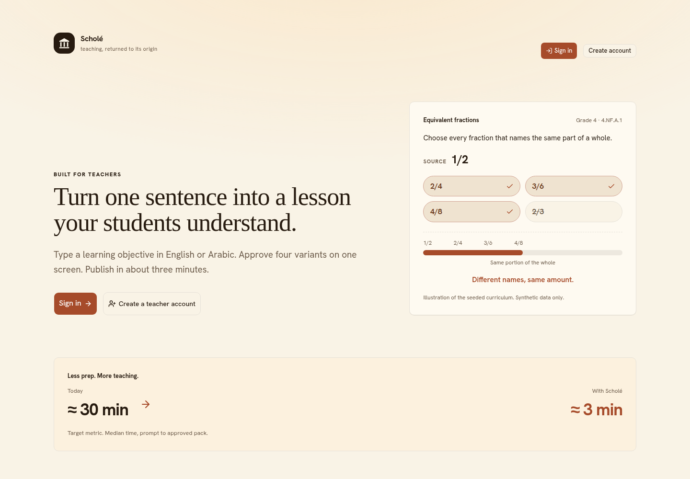

# Scholé

**Turn one sentence into a lesson your students understand.**

[](https://github.com/abodacs/edu-canvas/actions/workflows/foundation.yml) [](https://github.com/abodacs/edu-canvas/actions/workflows/security.yml)

Scholé (skoh-LAY) is a lesson-preparation workspace for Grades 3–6 teachers. The name comes from the Greek word for leisure and the root of "school": teaching, returned to its origin, so teachers get their time, focus, and creativity back.

A teacher describes an objective, reviews four structured lesson variants, and publishes the version students receive. The model drafts; the server checks structure, curriculum quality, learning quality, and safety; the teacher keeps the final decision.

The current release covers Grade 4 equivalent fractions (Common Core `4.NF.A.1`). English is the product language; lessons can also be generated in Arabic with RTL rendering. Everything runs on synthetic data.



## Why Scholé

Lesson planning is slow and repetitive. Most AI tools for teachers generate generic content, skip standards validation, and blur the line between teacher guidance and untrusted model output. Scholé is built around a different loop:

- **Teacher-gated.** Nothing reaches a student without a teacher-approved, immutable version.
- **Server-authoritative.** Answer keys, mastery logic, and permissions stay server-side; the client never submits a score.
- **Explainable.** A prerequisite path and a next-step story show what comes before and after, and why.
- **Structured, not conversational.** The model returns a validated draft that compiles into an allowlisted A2UI v0.9.1 catalog. No generated HTML or JavaScript runs in the browser.
- **Safety-first.** A deterministic gate blocks unsafe drafts before preview and before publication.

## How it works

1. The teacher enters an objective, grade, standard, and language.
2. The server requests a structured draft and validates structure, curriculum quality, learning quality, and safety.
3. The teacher reviews four variants, edits a section, and approves what students receive.
4. A published version is immutable. A student opens the assignment and submits answers.
5. The server grades the attempt and returns the approved reveal and a deterministic next-activity decision.

Generation, review, approval, publication, assignment, and server-side grading work today. The connection reveal and the read-only teacher results view are also live. Teacher override and pause are next; [Status](#status) separates what ships from what is planned.

## Quick start

Requires Node.js 26 or newer, pnpm 10.17.1, Docker, and a Meta API key.

```bash
git clone https://github.com/abodacs/edu-canvas.git
cd edu-canvas
pnpm install --frozen-lockfile
docker compose up -d postgres
cp .env.example .env
# Edit .env and set META_API_KEY to a server-side key.
set -a; source .env; set +a
pnpm db:setup
pnpm dev
```

Open `http://localhost:3000`. In development, sign in with the synthetic teacher `amira.north@example.test` and password `synthetic-pass-1`.

PostgreSQL and a server-side provider key are required; there is no in-memory runtime fallback. See the [foundation runbook](docs/foundation-runbook.md) for configuration, readiness, and redeploy details.

Run the full verification pipeline:

```bash
pnpm check   # static checks, tests, build, and browser probes
pnpm start   # terminal 1
pnpm smoke   # terminal 2
```

## Status

| Area | Working today |
| --- | --- |
| Generate and ground | PDF, TXT, and MD source upload; grounded generation of four variants; prerequisite learning path and forward story |
| Validate and preview | Curriculum, learning-quality, and hard safety gates; A2UI preview over SSE; moderation recovery for blocked requests |
| Review and publish | Per-target approval; immutable published versions |
| Teach and grade | Assignment; the `/learn` board; server-authoritative grading; the connection reveal; the deterministic next-activity decision; the read-only teacher results view |
| Operate | PostgreSQL persistence; shared request limits; health checks; security headers |

**Next:**

- Teacher override and pause ([#107](https://github.com/abodacs/edu-canvas/issues/107))
- Deployment quotas, rollback, and monitoring gates ([#104](https://github.com/abodacs/edu-canvas/issues/104))

The [Meta AI Developer Hackathon 2026](docs/hackathon/meta-global-2026/README.md) (October 26 – November 4) is the first external validation milestone, not the product goal. [ROADMAP.md](ROADMAP.md) owns the delivery order.

## Safety boundaries

- Answer keys, mastery, and permissions are **server-only** — never present in any client bundle or A2UI message.
- **No student images or identifying data** are sent to the model.
- Real student data is blocked until a **data-processing agreement (DPA), EU residency, security review, and consent** are in place; milestone deployments use **synthetic data only**.

## Stack

[TanStack Start](https://tanstack.com/start) with React 19 and TypeScript; PostgreSQL with [Drizzle ORM](https://orm.drizzle.team); Tailwind CSS and Base UI (shadcn/ui conventions); A2UI v0.9.1 over SSE with the `matching-v1` and `fractions-v2` catalogs; Zod contracts and Vitest. Runs on Node.js 26 and pnpm 10.17.1.

## Project map

| Start here | What |
| --- | --- |
| [`ARCHITECTURE.md`](ARCHITECTURE.md) | Runtime architecture, invariants, and engineering boundaries |
| [`ROADMAP.md`](ROADMAP.md) | Product direction, delivery order, and lifecycle gates |
| [`CONTRIBUTING.md`](CONTRIBUTING.md) | Local setup, issue reports, commits, and PR checks |
| [`CODING_STANDARDS.md`](CODING_STANDARDS.md) | Engineering and review rules |
| [`docs/README.md`](docs/README.md) | Documentation index and ownership |
| [`docs/security/threat-model.md`](docs/security/threat-model.md) | STRIDE threat model against implemented paths |
| [`docs/agdr/`](docs/agdr/) | Architecture decision records |
| [`docs/hackathon/meta-global-2026/focused-scope.md`](docs/hackathon/meta-global-2026/focused-scope.md) | Current event scope and execution plan |
| [`docs/hackathon/meta-global-2026/`](docs/hackathon/meta-global-2026/README.md) | Sprint guide, demo script, and evidence |

### Where the code lives

| Behavior | Start here |
| --- | --- |
| Teacher workspace | `src/routes/workspace.tsx` → `src/components/studio/teacher-studio.tsx` |
| Generation service and provider seam | `src/server/generation/service.ts` → `provider.ts` |
| Curriculum and learning-quality validation | `src/server/generation/curriculum-validator.ts`, `learning-quality-validator.ts` |
| Hard safety gate | `src/server/safety/artifact-gate.ts` → `artifact-enforcement.ts` |
| A2UI compiler and SSE delivery | `src/server/a2ui/compiler.ts` → `stream.ts` |
| Identity and persistence | `src/server/identity/`, `src/server/persistence/` |
| Source grounding and uploads | `src/server/grounding/` |
| Health checks and operator scripts | `src/server/health.server.ts`, `scripts/` |
| Learner path | `src/routes/learn.tsx`, `src/server/learner/` |

Routes stay delivery modules. Domain rules, tenant checks, and public projections belong behind the named server seams; `src/shared/` holds only data the browser is allowed to receive.

## Contributing

Read [CONTRIBUTING.md](CONTRIBUTING.md) before opening an issue or pull request. Run `pnpm check` before pushing; it covers formatting, linting, type checks, architecture checks, tests, the build, and the browser probes.

## Security

Report vulnerabilities privately through [GitHub Security Advisories](https://github.com/abodacs/edu-canvas/security/advisories/new). Do not open a public issue for a suspected vulnerability.

## License

No reuse license has been granted yet. The repository is public for review; open an issue to discuss reuse.

## Governance

Scholé is governed under [ApexYard](https://github.com/me2resh/apexyard).
