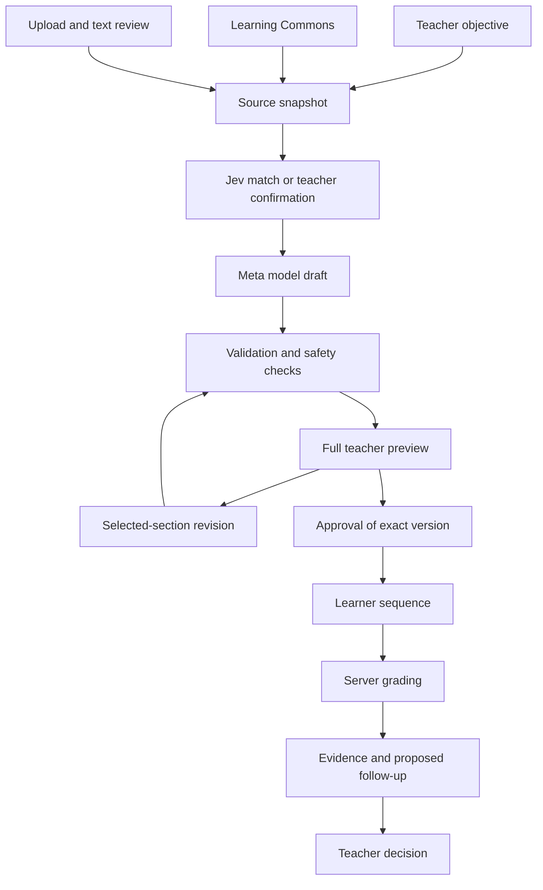
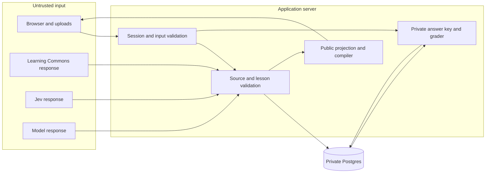

# One Useful Loop

Help a teacher prepare, approve, and teach a lesson on equivalent fractions, then choose the next activity from learner evidence.

This design is for the engineer who will build the lesson workflow. Start with the scope below. Then use the contracts and delivery steps in the companion document.

| Field | Value |
| --- | --- |
| Owner | Abdullah |
| Revision | 2026-10-24 |
| Design status | Questions answered; technical choices specified |
| Build status | Awaiting the existing UI approval and verification skills |
| Evidence status | Code inspected; new service calls and acceptance checks remain untested |
| Planned demonstration | Under three minutes, by November 4, 2026 |

The [UI implementation gate](../product/teacher-ui.md#implementation-gate) still applies. This document prepares implementation; it does not record approval that has not occurred.

## Find the information you need

| Your task | Read |
| --- | --- |
| Understand the feature | This document |
| Build a feature or handle a failure | [Implementation contracts](design-doc-implementation.md) |
| Find an answer or its reason | [Decision record: Q1–Q20 and UI questions](design-doc-questions.md) |
| Understand terms and writing rules | [Reading guide](design-doc-reading-guide.md) |
| Record actual results | [Validation tracker](../hackathon/meta-global-2026/validation-tracker.md) |

## Build the complete agreed lesson workflow

The first release covers English, Grade 4, and Common Core standard `4.NF.A.1`. A teacher supervises the learner. Home use and Arabic remain later product goals.

A lesson package contains a worked example, guided practice, an independent check, corrective feedback, and approved follow-up choices. A worked example shows each solution step. An independent check measures the first response without hints.

The full [UI feature set](../product/teacher-ui.md#agreed-direction) remains in scope:

- A plain-language objective and evaluated Jev matching.
- Learning Commons sources, required skills, and prerequisites.
- A panel with source links and coverage gaps.
- Selectable-text PDF, TXT, and Markdown uploads.
- One offered grounding retry, followed by upload recovery.
- An adjustable fraction diagram, guided hints, and an independent check.
- Correct LaTeX output in the teacher and learner views.
- Changes to one selected section, with checks of related sections.
- Teacher approval, server grading, evidence, and teacher follow-up decisions.

The model creates original material from the selected sources. The application controls the components, grading rules, approval, and follow-up choices.

### Keep these features outside this release

Website imports, scanned-document recognition, publisher-lesson adaptation, and a general knowledge map remain deferred. So do LMS integration, parent accounts, and production administration.

The release does not generate new material during learner use. It makes no claim of mastery or measured learning improvement. Four existing content variants are not four teaching stages.

## Use the existing foundation without overstating its coverage

The current code contains generation, validation, persistence, and a bounded matching preview. A bounded preview accepts only named components and actions.

The current factory selects a fixture or OpenAI provider. It does not select a Meta provider. The current provider request has no educational-source snapshot. The current `matching-v1` catalog has no fraction-diagram or math component.

The expanded design therefore needs new contracts and adapters. The [code inventory](design-doc-implementation.md#existing-code-and-required-changes) identifies the files. The inventory describes this checkout, not a deployment or a fresh `origin/main` checkout.

October's explicit UI decisions govern conflicts with earlier sprint defaults. The expanded target exceeds the earlier core-loop design. The [decision record](design-doc-questions.md) resolves those conflicts without treating old defaults as new owner approval.

## Follow the teacher and learner paths

### Prepare and approve a lesson

1. Enter an equivalent-fractions objective.
2. Resolve the standard and required skills from Learning Commons.
3. Confirm the match when Jev confidence is 0.90 or lower.
4. Generate the lesson after the source checks pass.
5. Review the complete sequence, source gaps, and feedback branches.
6. Request a section change if necessary.
7. Approve the exact validated version for learner use.

Jev confidence above 0.90 removes only the match-confirmation step. The evaluation must pass first. Unsupported objectives always require clarification. Teacher publication approval remains mandatory.

### Teach and choose the next activity

1. Show a worked example, such as `1/2 = 2/4`.
2. Let the learner adjust equal-sized fraction diagrams.
3. Offer hints during guided practice.
4. Present a fresh independent item, such as `2/3 = 4/6`.
5. Save the first response before corrective feedback.
6. Save each retry as a separate attempt.
7. Let the teacher accept, pause, or replace the proposed follow-up.

The teacher sees first responses, hint use, retries, and the reason for the proposal. A correct retry does not replace an incorrect first response.

### Recover from missing sources or failed generation

Learning Commons failure offers one teacher-controlled retry. A second failure offers lesson upload. Missing prerequisites permit generation with a visible warning. Missing standards or required skills require recovery.

Incomplete PDF extraction stops generation. The teacher supplies corrected text or another supported file. The application identifies the affected pages and preserves the objective.

A model timeout preserves the request and offers an explicit retry. Invalid output permits one automatic correction within the request deadline. Safety blocks require a changed request. Fixtures and recordings carry visible labels.

## Keep external data outside trusted application rules

Supabase Postgres is an external storage boundary. The server accesses Postgres with private credentials. The browser receives only permitted projections.

## Preserve these rules at every boundary

| Rule | Required behavior |
| --- | --- |
| Sources | Store source identifiers, retrieval time, version information, and a content hash. Show gaps. |
| Untrusted text | Treat uploads and provider text as data. Never execute embedded instructions or markup. |
| Approval | Publish only a validated version that the teacher reviewed. Reject stale approval requests. |
| Revision | Create a new version. Preserve other sections. Flag dependency conflicts. Require approval again. |
| Grading | Calculate results on the server. Keep the answer key out of browser payloads and logs. |
| Attempts | Store immutable responses against the exact published version. Separate assistance and retries. |
| Follow-up | Apply fixed rules. Let the teacher choose only from approved activities or pause. |
| Access | Derive identity and role from a protected server session. A browser role parameter grants no authority. |

The [implementation contracts](design-doc-implementation.md) define request fields, state changes, errors, and acceptance checks for these rules.

## Keep the deployment small and controlled

Use one continuously running Fly.io instance with Supabase Postgres. The server must support server-sent events, or SSE, for preview updates. Keep database access and provider keys on the server.

This design uses process-local request limits. Multiple instances require shared limits first. The [release runbook](../release-fly-supabase.md) was updated on 2026-10-25 to this single-instance demo with database-backed quotas and process-local burst limits ([#89](https://github.com/abodacs/edu-canvas/issues/89)); deployment details are recorded in [AgDR-0007](../agdr/AgDR-0007-demo-access-and-deployment.md).

Keep the current dependency lockfile. Select and pin any new parser or math renderer during the approved implementation. Reuse the generation interface and retain the fixture path for deterministic checks.

Only synthetic learner data and approved demonstration materials enter this demo. Upload access requires a protected teacher session. Synthetic data alone does not settle provider terms, upload rights, or event eligibility.

## Measure the demonstration separately from production targets

A service level objective, or SLO, is a measurable service target. These are proposed targets, not observed results.

| Measurement | Demo target | Evidence |
| --- | --- | --- |
| Complete demonstration | Under 180 seconds | Three consecutive rehearsals |
| Live generation to complete preview | p95 at most 30 seconds | At least 20 sequential requests after source confirmation |
| Grounding and matching | Report separately | Duration, failures, and recovery results |
| Demo access | Protected URL works during judging | Independent access check and manual checks |
| Public usage | Access and cost limits active | Rejection and quota checks |

For 20 durations, sort values from shortest to longest. The nineteenth value is the nearest-rank p95. Report sample size and failures alongside the result. Twenty requests provide a demo observation, not a production reliability claim.

Earlier production targets remain reference values: 10-second draft p95, 500-millisecond render p95, and 99.9% published availability. This sprint does not establish those targets.

Record request IDs, state changes, durations, and provider/model/prompt/validator versions. Record source, catalog, grading-rule, and next-step-rule versions too. Keep raw uploads, prompts, answer keys, credentials, and learner responses out of operational logs.

Use Sentry and the existing health/readiness routes. Database records hold authorized lesson and attempt evidence. No claim is made that logs can reconstruct every failure.

## Deliver in units with observable results

Use the [implementation order](design-doc-implementation.md#implementation-order-and-exit-checks). Each unit has dependencies and a visible exit check. Run teacher review as soon as a reference lesson exists.

The [sprint guide](../hackathon/meta-global-2026/README.md#ten-day-execution-budget) owns the existing schedule. The [validation tracker](../hackathon/meta-global-2026/validation-tracker.md) owns observed evidence. The earlier dates remain provisional planning checkpoints pending the capacity decision: V3 October 27, V6 October 29, V8 October 31, and V11 November 4.

The expanded scope exceeds the earlier 30-hour plan; the companion estimate shows the gap (36–57 hours, UQ3). Keep all agreed features in scope until Abdullah explicitly changes scope or capacity.

## Complete the remaining evidence and authorization tasks

All design questions have answers. The following tasks need evidence or an owner action; prose cannot complete them.

| ID | Owner | Required result | Blocks |
| --- | --- | --- | --- |
| E1 | Abdullah | Explicit UI build approval and verification skill paths | UI implementation and integration probes |
| E2 | Builder | Recheck inventory on an isolated checkout from current `origin/main` | Reliable execution estimate |
| E3 | Abdullah | Reconcile full scope with available capacity | Credible delivery commitment |
| E4 | Builder | Prove model access and exact Learning Commons coverage after E1 | Live grounded generation |
| E5 | Abdullah | Record event reuse rules and allowed-model evidence in V1 | Eligibility claims |
| E6 | Builder | Run Jev evaluation and all acceptance checks | Automatic matching and release claims |
| E7 | Abdullah | Record teacher recruitment and workflow observations | Teacher-value claims |
| E8 | Builder | Complete the fresh-checkout false-success regression check | Learner-safe demonstration |

The notes directory was Git-ignored when this revision was written. Update 2026-10-24: the reviewed documents now live in tracked paths under `docs/`. Preserve unrelated work and existing worktrees.

## Understand the important alternatives

**Direct model-generated UI:** rejected because executable output would widen the trust boundary. Use validated lesson data and application-owned components.

**Client grading:** rejected because the browser would need private answers. Retain [server-authoritative grading](../agdr/AgDR-0002-server-authoritative-grading.md).

**Unlimited retries:** rejected because cost and duration would have no bound. Separate source retry, model correction, and teacher retry.

**MCP for Learning Commons:** use REST first for a fixed, bounded query sequence. Reconsider transport only if measured access requires a change.

**Omitting uploads, retrieval, or Jev:** rejected because the explicit UI interview includes these features. A capacity problem requires an explicit scope decision.

**Worksheet reuse and specialist tools:** retain these as teacher-workflow comparisons. Measure total teacher effort before claiming an advantage.
