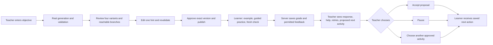

# Build the focused teacher-controlled loop

Planning draft, 2026-10-26. This translates [focused-scope.md](focused-scope.md) into proposed screens and an issue order. The focused scope owns event commitments. [Epic #108](https://github.com/abodacs/edu-canvas/issues/108) owns the broader production direction. Screen proposals below need review before implementation.

See the [issue dependency graphs](issue-graphs.md) for the focused sequence, public-access prerequisites, and broader production work.

## Start with the real generation path

Complete IC1 before extending the interface. Use #117, the focused slice of #115, and #105 to prove a real allowed-model request reaches validation and the existing preview. Reject unsupported objectives explicitly. Record the provider, model, commit, and observed result. A fixture pass cannot satisfy IC1.

The current teacher page already has a composer, variant summaries, diagnostics, and an interactive semantic preview. Its student page still shows foundation information. Approval, learner grading, and teacher decisions need application behavior behind their controls.

Reuse the current paper background, green accent, Hanken Grotesk type, buttons, and cards. Current CSS is the visual reference. The older `.impeccable.md` mentions a blue accent and needs reconciliation before it guides new design.

## Use three workspaces

The teacher prepares and reviews one lesson, the learner completes it, and the teacher chooses follow-up. Keep these workspaces within the existing demo shell. Show one active task at a time on phones.



The four variants are content options. Worked example, guided practice, and independent check are stages. Keep separate controls and labels for these two concepts.

## Design the teacher review workspace

The primary action changes from **Create draft** to **Approve variant**, then **Publish approved pack** as work progresses.

```text
Edu-Canvas                  Prepare | Review | Learner evidence

Equivalent fractions                 Grade 4 · English · Draft
Objective [Help learners recognise equivalent fractions...]
[Create draft]

Curriculum reference: 4.NF.A.1 · curated reference [Details]

Variants                 Selected variant preview
Core A      Reviewed     [Example | Guided | Independent]
Core B      Needs review Fraction bars, instructions, matching
Support     Needs review
Challenge   Needs review Hint [editable text................]
                         [Save hint and revalidate]
                         Warning or blocker with field link
                         [Approve this variant]

1 of 4 variants approved · Flow and branches need review
[Publish approved pack]  Available when every check passes
```

Use a compact variant list beside one preview on desktop. Stack the list above the selected preview on phones. Show stage and branch previews within each variant where applicable. Avoid repeating the entire lesson in both a summary card and a second preview.

Make the source reference inspectable, with its provenance. Label it as curated. Keep source ingestion and upload controls outside this event flow.

Approve every variant and every branch that can reach the learner, including the bounded explanation required by #19. Display what remains unapproved beside the publish control. Validation warnings stay visible and can be acknowledged. A hard blocker stops preview and publication and links to the affected field.

Save the hint edit on the server and revalidate. Invalidate approval for the changed content and its affected flow. Preserve other lesson content. Publish the exact reviewed revision and hash. After publication, an edit creates a new version requiring approval. Existing learner runs retain their original version.

After publication, show the saved version and **Open synthetic learner**. The server must authorize the learner independently of this navigation control.

## Design the learner workspace

Use a focused lesson screen with a short stage indicator and one primary action. Render the current permitted stage only.

```text
Equivalent fractions                      Guided practice
Example  >  Practice  >  Check

Which fractions show the same amount?
Equal-sized fraction bars and a text equivalent

Choose a source, then its matching targets.
[1/2]                 [2/4] [3/6] [2/3]
Selected pairs with a clear removal action

[Show hint]                            [Done]
```

The example explains one relationship. Guided practice allows saved hints. The independent check uses a fresh item and captures the first response before offering help. Preserve the first response and later hints or retries as separate evidence.

Keep matching usable with clicks, taps, and keyboard controls. Announce selection changes. Use labels and patterns as well as color. Display simple fraction bars with equal-sized wholes and an accessible text equivalent.

On **Done**, submit selections only. Wait for the saved server grade before showing feedback. A wrong or partial answer receives specific corrective feedback. Never show a success reveal for an incorrect response. Return only feedback and answer details permitted after submission.

When no follow-up decision exists, show **Your teacher is choosing the next activity**. A saved pause keeps that waiting state. A saved teacher choice opens the corresponding approved activity.

## Design the teacher follow-up workspace

This is the decisive demo moment. Show one synthetic learner and one completed check, with enough evidence to choose a next step.

```text
Learner evidence                  Synthetic learner · Version 1

First independent response: Incorrect
Response: [the learner's submitted pairs]
Guided hints: 1       Later retries: 0

Proposed next activity: Extra support
Reason: The first independent response was incorrect.
[Preview approved activity]

[Use proposed activity]  [Pause]  [Choose another approved activity]
```

Show the response and explanation before aggregate scores. Keep first response, guided help, and later retries distinct. Use tentative recommendation language. Do not infer mastery or diagnose a misconception from the synthetic response.

The alternative picker contains approved activities within the permitted scope. Save the choice against the current evidence version. A stale proposal requires refresh and review. Confirm the actual saved choice, then verify that the learner receives it.

## Define recovery beside each action

| Trigger | Visible recovery |
| --- | --- |
| Unsupported objective | Explain Grade 4 equivalent-fractions scope and preserve the objective for correction. |
| Provider timeout or quota | Preserve the request. Offer the permitted retry or wait interval. Never substitute a fixture silently. |
| Moderation block | Preserve the objective and ask for a revised request. Do not retry unchanged content automatically. |
| Hard validation block | Identify the affected variant or field and its repair action. Prevent preview and publication. |
| Preview disconnect | Reconnect or reload saved request status without starting another generation. |
| Concurrent edit or stale approval | Show that the version changed and require review of the current version. |
| Submission fails or response is lost | Preserve selections and reconcile the same operation before offering another submit. |
| No approved next activity | Pause and explain what the teacher must approve. |
| No learner attempt | Show **Waiting for the learner's first response** with the approved lesson link. |

## Address existing issues in this order

Timeboxes below reuse the 30 hours in focused-scope.md. They are planning assumptions, not measured estimates. The six-hour reserve stays separate. Keep work sequential for one builder.

| Order | Existing issues | Focused deliverable and exit check |
| --- | --- | --- |
| 1 · IC1 · 5 h | #117, #115, #105 | Fresh inventory and required verification; real allowed-model draft reaches validation and preview; unsupported input fails. Use a curated reference instead of U2 integrations. |
| 2 · IC2a · 3 h | #73, #28, bounded #19 | Refresh the relevant threat paths, enforce preview and publication blockers, and persist the approved explanation needed by the lesson sequence. |
| 3 · IC2b · 4 h | #5; required storage from #112 | Review, edit one hint, revalidate, approve, publish, and assign an immutable pack. An approved pack opens for the learner; an unapproved pack does not. |
| 4 · IC3a · 4 h | focused #116, #6 | Example, guided matching, fresh check, saved assistance, server grade, and immutable attempts. A wrong answer receives correct feedback. |
| 5 · IC3b · 4 h | #7, focused #8, #107 | Teacher sees actual evidence and changes the next approved activity. The learner receives that saved decision. |
| 6 · IC4 · 4 h | focused #9 and #10, #74, #27 regression | Keyboard and phone use, protected demo, quotas, refresh, double-submit, and failure recovery. Three consecutive full-loop rehearsals pass. |
| 7 · 6 h | #11 | Fresh-browser access, recording, README, release evidence, and fixture/live labels agree with actual behavior. |

#74 is a public-hosting prerequisite. Complete it before exposing provider-backed endpoints outside the trusted development environment, even if the integrated rehearsal occurs in block 6. #73 informs #28. Preserve these dependencies when scheduling.

Treat #112 as ownership for the records this loop requires. Avoid starting the complete source-ingestion storage plan first. Resolve #110 if fixture catalog drift affects the chosen path. Keep the existing catalog reader and give any new component or action an explicit versioned contract.

For #116, implement the fraction display and keyboard interaction required by the focused lesson. Full MathText, adjustable diagrams, and fractions-v2 acceptance remain broader work unless the focused path proves they are necessary.

Keep #113, #114, automatic matching in #106, #98–#104 production expansion, #109, and #29–#31 outside this event implementation. Start reachable teacher feedback early when possible. Do not make the full five-teacher, two-week study a code-delivery prerequisite.

The 2026-10-26 follow-up filled all 21 placeholder bodies under #108 with source-backed scope, focused event boundaries, dependencies, acceptance criteria, and verification steps. The epic now includes the dependency graphs. These specifications remain unverified implementation work; a `ready-for-agent` label does not prove that a dependency or acceptance check has passed.

Reference a broader issue in a focused PR. Close it only when its full acceptance criteria pass. In particular, English accessibility work does not close bilingual #9 or #10.

## Use the installed skills selectively

| Work | Installed skill and concrete output |
| --- | --- |
| Capture confirmed product facts | `impeccable init`. Reuse focused-scope.md and existing product decisions to create PRODUCT.md without repeating settled interviews. |
| Confirm these screen interactions | `impeccable shape`. Resolve review, branch preview, and follow-up choices before application edits. |
| Implement bounded React components | `typescript-best-practices`, `vercel-react-best-practices`, and project `ultracite`. Keep domain decisions behind server seams. |
| Make recovery actionable | `clarify` and `harden`, scoped to the table above. |
| Verify keyboard and phone behavior | `audit` and `adapt`, plus the installed browser skill against the running loop. |
| Protect draft validation | Project `verify-lesson-gate` when draft contracts or acceptance rules change. |
| Finish the shipped screens | One scoped `polish` pass after the behavior works. |

Use current components and tokens as the visual reference. Record that reference in DESIGN.md when the design workflow requires it. Avoid a separate redesign during this event.

`verify-lesson-gate` covers sampled structural properties. It does not prove mathematical correctness, pedagogy, publication, grading, or browser interaction. No dedicated content or pedagogy verification skill was found in the inspected installed skill files. The teacher-UI implementation gate still requires Abdullah's named verification coverage for all four areas. Recommended next artifact: a project verification skill with reviewed fraction examples, explicit grading cases, and a browser walkthrough of IC1–IC4. Confirm its name or provide existing skills before dependent application changes.

## Keep implementation behind named seams

Reuse `src/routes/demo/$role.tsx` for the existing demo entry. Move growing screen composition into focused components as those screens land. Keep the route as a delivery module.

Reuse `src/components/a2ui/lesson-preview.tsx` and its renderer for allowed lesson components. Teacher review, source details, and decision controls use ordinary React UI. Extend the A2UI contract explicitly when the learner needs a new trusted component or action.

Put public projections in `src/shared/`. Keep private answer relationships, approval eligibility, grading, authorization, and next-activity rules on the server. Derive displayed state from saved records. Keep only unsaved input and transient selections local.

Add the records needed for publication, assignment, run, attempt, assistance, proposal, and teacher choice through additive migrations. Never infer approval for legacy drafts.

## Verify each completed block

For application changes, run `pnpm check` and relevant behavior tests. Run `pnpm test:database` against a dedicated test database for persistence changes. Run `pnpm verify:lesson-gate` when covered contracts change. Build, start, and run `pnpm smoke` for release behavior.

Exercise the running UI with keyboard alone and at a 320-pixel viewport. Check focus after transitions, readable math, pending states, and recovery. Record real-model evidence separately from fixture evidence. Rehearse correct, wrong, partial, and distractor-only responses. Confirm publication versions, first-response evidence, and saved choices survive reload.

## Resolve before dependent implementation

- Name the required content, pedagogy, rendering, and interaction verification skills, or approve creating the proposed focused-loop skill.
- Confirm model access and remaining capacity through IC1 and #117. Re-estimate after the observed result.

The proposed UI uses the existing visual system, one synthetic learner, four reviewed content variants, and a teacher-confirmed next activity. These are the defaults for design review, not claims of completed behavior.
