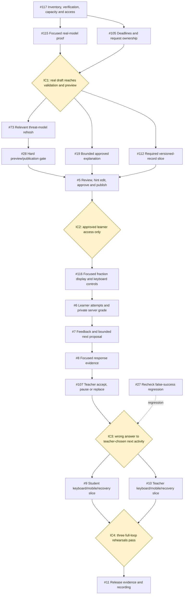
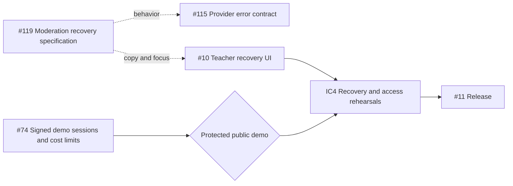

# Issue dependency graphs

Updated 2026-10-26 from [focused-scope.md](focused-scope.md), [epic #108](https://github.com/abodacs/edu-canvas/issues/108), and the current issue specifications. These graphs describe planned dependencies, not completion status.

The focused event is the active build. The broader production work stays open. An event slice does not satisfy every acceptance criterion in its parent issue.

## Build the focused loop first

Solid arrows show prerequisites in the selected event sequence. Dashed arrows show supporting work or targeted checks. The IC1 proof uses the existing preview and one curated reference. It does not wait for live Learning Commons, uploads, Jev, or the complete fractions-v2 catalog.

Work is sequential for one builder. Multiple arrows into a node do not imply concurrent staffing. Follow the focused scope's 5 + 7 + 8 + 4 + 6 hour timeboxes and separate six-hour reserve. Re-estimate after IC1.

## Protect public access and define recovery

#74 must pass before any provider-backed public demo. Its placement below is a release prerequisite, not permission to expose the app before the protection exists. #119 specifies moderation recovery; #115 and #10 implement it.

## Keep the production backlog separate

Solid arrows below represent the broader contract or gate dependencies documented in #108 and the design contracts. Dashed arrows are related evidence or follow-up, not a requirement to finish whole epics before scoped work can begin.

```mermaid
flowchart TD
    subgraph Grounding["Grounding and expanded authoring"]
        I117["#117 Broader access and inventory evidence"]
        I112["#112 Complete versioned-record contract"]
        I113["#113 Learning Commons snapshots"]
        I114["#114 Upload extraction and repair"]
        I106["#106 Reviewed matching evaluation"]
        JEV["Jev adapter: specified in design; no dedicated child issue"]
        I115["#115 Full grounded U3 package"]
        I116["#116 Full fractions-v2 math controls"]
        I110["#110 Fixture/catalog compatibility"]
        I117 --> I112
        I112 --> I113
        I112 --> I114
        I113 -. recovery route .-> I114
        I112 --> JEV
        I113 --> JEV
        JEV --> I115
        I106 --> AUTO["Automatic matching may be enabled"]
        JEV --> AUTO
        I113 --> I115
        I114 --> I115
        I115 --> I116
        I110 -. compatibility .-> I116
    end

    subgraph Production["Real-user protection and operations"]
        I74["#74 Demo access baseline"]
        I98["#98 Real identity and authorization"]
        I99["#99 Accounts, class and invitations"]
        I72["#72 Residency evidence"]
        I100["#100 Database role, backup, seed and pool"]
        I101["#101 Agreements, consent, retention and deletion"]
        I102["#102 Reviewed legal disclosures"]
        I103["#103 TLS, alerts, logs and rotation"]
        I104["#104 Shared limits and honest topology"]
        I109["#109 Class-size load test"]
        REAL{"Real student data stays gated"}
        I74 --> I98
        I98 --> I99
        I72 --> I100
        I100 --> I101
        I101 --> I102
        I74 --> I104
        I104 --> I109
        I99 --> REAL
        I101 --> REAL
        I102 --> REAL
        I103 --> REAL
        I104 --> REAL
    end

    subgraph Evidence["Teacher value and maintenance"]
        I94["#94 Domain evidence"]
        I118["#118 Five teachers, two-week study"]
        I58["#58 Value and adoption validation"]
        I111["#111 Unique AgDR identifiers"]
        I94 -. protocol .-> I118
        I118 --> I58
    end
```

The real-data gate above summarizes this issue set. The release runbook remains authoritative for the complete production checklist. Backup and residency evidence, signed agreements, consent, and measured operations remain separate evidence tasks.

The graph exposes one tracking gap: the broader Jev adapter is specified in U2 but lacks a dedicated child issue. #106 owns evaluation, #113 owns Learning Commons, and #114 owns uploads. Do not silently assign the whole adapter to one of those issues. Create a bounded implementation ticket when that integration enters scope.

Platform epics #29, #30, and #31 remain deferred. Arabic completion stays in the remainder of #9/#10. #68/#70/#71 are quality work outside the focused critical chain. #121 remains structural gate verification, with broader validation coverage still owned by #28 and the selected verification plan.

## Read or update an issue

Start from its focused event boundary, then its dependencies and acceptance criteria. Preserve the broader scope when recording a partial event result. Attach the commit, environment, observed result, and limits to the owning issue.

The 21 placeholder bodies under #108 were specified from the existing repository contracts. The issue text does not claim any implementation, agreement, recruitment, or test result has completed.
